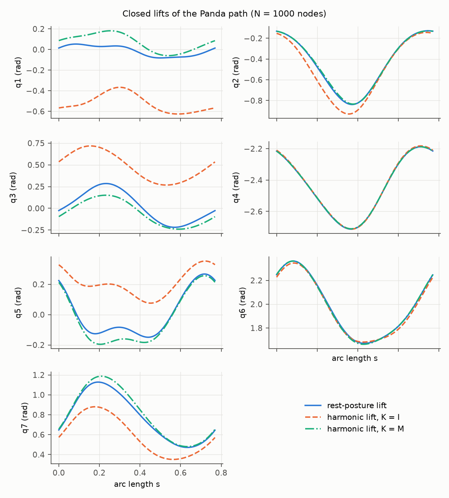
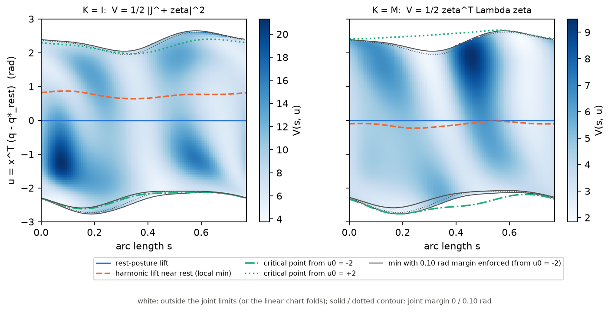
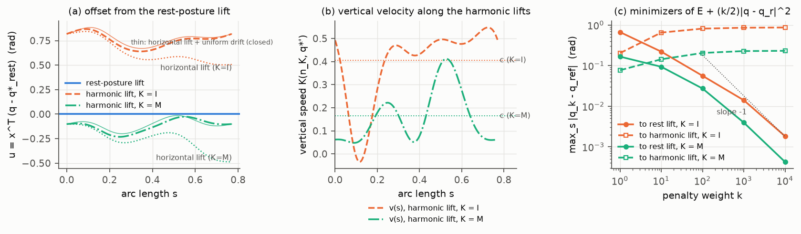
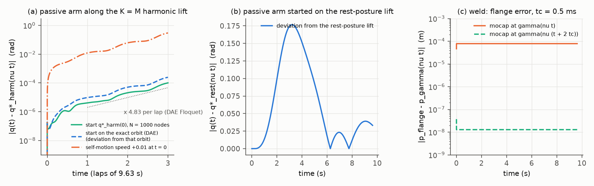
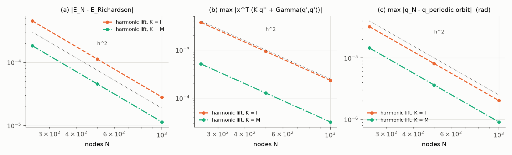

# Closed lifts and closed frames along the path loop

### Holonomy, harmonic sections, and what is canonical. A note for *Pose Path Following using Normal Tubular Coordinates*

*2026-10-15. This note combines four inputs from this folder: the theory note (`theory.md`), the adversarial review
(`alternatives.md`), the independent numerics (`num/`) and the referee's re-derivations and checks (`referee/`). Where
they disagreed, the referee's corrected version is used, and each correction is stated where it applies. The notation is
the paper's: twists $\zeta=(\omega,v)$, body Jacobian $J_b$, a left-invariant metric $W$ on $SE(3)$, and the unit-speed
path $\gamma:\mathbb R/L\mathbb Z\to SE(3)$ with $\zeta_\gamma=(\gamma^{-1}\gamma')^\vee$ and
$\Vert\zeta_\gamma\Vert_W=1$. $\mathbb K$ is a Riemannian metric on the joint space, as in Lemma 3.*

**Status tags.** Every claim carries exactly one tag.

| tag | meaning |
|---|---|
| **[P]** | proven here, with a complete proof (in the text or in Appendix A) |
| **[PH]** | proven under the hypotheses stated with it |
| **[PS]** | proof only sketched; treat it as not yet proven |
| **[K]** | known result, cited and not re-proven (citations were given from memory and have not been re-checked) |
| **[N]** | numerical observation on the paper's Panda example (evidence, not proof); its source is listed in Appendix B |
| **[C]** | conjecture or open question |
| **[F]** | false as stated; a counterexample is given |

---

## 0. Summary

**The question.** Is there an elegant differential-geometric definition of the closed lift $q^\star$ of Assumption 1? It
should make closure automatic and put the lift and the frames $N$ (Lemma 1) and $X$ (Lemma 3) under one principle. The
working hypothesis said yes: closed lifts are sections of the self-motion bundle, the canonical lift is its *harmonic
section* (the minimiser of $\tfrac12\oint|q'|^2_{\mathbb K}$), and $N$, $X$ and $q^\star$ are all harmonic sections.

**The answer, in four points.**

1. **Frames: yes, and it is a theorem.** The paper's frame $N_0e^{-(s/L)\Phi}$ is, up to a constant $Q_0\in O(5)$, the
   unique closed frame of **least twist**. It minimises $\tfrac12\oint\Vert N^\top WN'\Vert_F^2$, with minimum
   $\sum_i\theta_i^2/L$, and it is unique modulo $Q_0$ iff $-1$ is not an eigenvalue of the holonomy $H$. The critical
   points are the Coulomb gauges, one for each real logarithm of $H$. The same holds for Lemma 3's $X$ (Theorem A, §3)
   [P].
2. **Lift: the energy does not select one.** On the paper's own Panda path the harmonic energy has **three strict local
   minima** in the single homotopy class, for both $\mathbb K=I$ and $\mathbb K=M$ [N]. For $\mathbb K=I$ the global
   minimum lies 0.033 rad from joint 2's limit, inside the 0.10 rad safety margin. For $\mathbb K=M$ it violates joint
   2's limit by 0.33 rad [N]. The shoulder involution $\sigma$ (§6.2) gives every $\mathbb K=I$ critical lift found an
   equal-energy twin on another admissible component [N]; without joint limits every lift has one [P]. The near-rest
   harmonic lift that the first numerics reported is only the minimiser of the rest posture's basin. In that sense
   **$q_r$ still selects it** [N].
3. **Lift: a pointwise criterion, with closure proven.** Closure of the rest-posture lift does not need to be "checked".
   It follows from a short proposition: if $f=\tfrac12|q-q_r|^2$ has a unique, nondegenerate, interior minimum on the
   admissible self-motion manifold over every $\gamma(s)$, then $q^\star=\sigma_f\circ\gamma$, where $\sigma_f$ is a
   smooth local inverse kinematics. So $q^\star$ is smooth and closed (Theorem B, §4.1) [P]. On the Panda path the
   hypotheses hold with wide margins [N].
4. **Harmonic lift: a remark with real physics.** Its Euler–Lagrange equation is
   $X^\top(Mq''+C(q,q')q')=0$. Equivalently, the gravity-free arm is dragged along the path at constant speed by its
   flange alone, with zero dynamically consistent null-space torque (Theorem C) [P]. Every nondegenerate minimiser is a
   **hyperbolic, unstable** periodic orbit of that passive motion (Theorem D) [P]. The Panda's multipliers are 3.8–5.2
   per lap for $\mathbb K=I$ and 4.8 for the near-rest $\mathbb K=M$ lift, which MuJoCo reproduces [N]. The rest-posture
   lift is the $k\to\infty$ limit of the minimisers of $\mathcal E+\tfrac k2\oint|q-q_r|^2$ [PH], with an $O(1/k)$
   corrector [PS] whose constant (18.9) is confirmed numerically (18.84 at $k=10^5$) [N].

**What to put in the paper** (the referee's recommended construction, §2.2):

- add Theorem A as a proposition after Lemma 1 (minimal-twist closed frames), and note that it also covers $X$;
- keep the rest-posture lift and the code, and replace "we then check that the result closes" by Theorem B;
- mention the harmonic lift and the family $\mathcal E_k$ only in a remark (passive dragged arm, zero null-space torque,
  hyperbolic, several minima);
- do not claim one variational principle for the lift.

**The principle, stated honestly (§2.1).** Every object the controller needs along the path is a section of a natural
bundle over the loop $\mathbb R/L\mathbb Z$. Two mechanisms make such a section close:

- **(I) a function of the pose.** A smooth local inverse kinematics $\sigma$ is defined near the path by a fibrewise
  criterion, and closure is free.
- **(II) transport with holonomy cancellation** in a compact structure group. Theorem A shows that this is the least-twist
  (Coulomb) gauge.

The frames use (II), and their variational characterisation coincides with it. The lift uses (I): its structure group
is $\mathrm{Diff}(F)$, which has no usable logarithm, and its energy is not convex.

---

## 1. The problem in bundle language; why naive lifts drift

### 1.1 Setting

$\mathsf Q$ is the joint space ($\mathbb R^n$, or $T^n$ for unlimited revolute joints), $n=6+r$, and $\Pi$ is the
forward kinematics.

- $\mathsf Q_{\rm reg}=\{q:\operatorname{rank}J_b(q)=6\}$, the regular configurations.
- $B=\prod_i[q_i^-,q_i^+]$, the joint box.
- $\mathsf Q_{\rm adm}=\mathsf Q_{\rm reg}\cap\operatorname{int}B$, the admissible configurations.

The **vertical bundle** $\mathsf V_q=\ker J_b(q)$ has rank $r$. Its leaves are the self-motion manifolds (Burdick
1989). For $r=1$ it is spanned by the unit generalised cross product $x(q)$ of the rows of $J_b(q)$ (the paper's
construction), so it is trivial and oriented [P].

Given a metric $\mathbb K$ on $\mathsf Q_{\rm adm}$ (for example $I$, $M(q)$, or the barrier metrics of §4.4), set

$$
\Lambda_{\mathbb K}=(J_b\mathbb K^{-1}J_b^\top)^{-1},\qquad J^\#_{\mathbb K}=\mathbb K^{-1}J_b^\top\Lambda_{\mathbb K},\qquad
\mathcal V=I-J^\#_{\mathbb K}J_b .
$$

$\mathcal V$ is the $\mathbb K$-orthogonal projector onto $\mathsf V$, and $\mathcal H=\mathsf V^{\perp_{\mathbb K}}$ is
an Ehresmann connection on $\Pi|_{\mathsf Q_{\rm adm}}$. For $\mathbb K=I$, $J^\#$ is the Moore–Penrose pseudoinverse.
For $\mathbb K=M$, it is Khatib's dynamically consistent inverse $\bar J$, and $\Lambda_M$ is the operational-space
inertia [K: Khatib 1987]. Because $w=J^\#J_bw+\mathcal Vw$ is a $\mathbb K$-orthogonal splitting [P],

$$
\lvert J^\#_{\mathbb K}\zeta\rvert_{\mathbb K}^2=\zeta^\top\Lambda_{\mathbb K}\zeta,\qquad
\lvert w\rvert^2_{\mathbb K}=(J_bw)^\top\Lambda_{\mathbb K}(J_bw)+\lvert\mathcal Vw\rvert^2_{\mathbb K}. \tag{1.1}
$$

### 1.2 Closed lifts are sections

$$
\mathcal S:=\{(s,q)\in\mathbb R/L\mathbb Z\times\mathsf Q_{\rm adm}:\ \Pi(q)=\gamma(s)\},\qquad p(s,q)=s,\qquad
\mathcal S_s:=p^{-1}(s).
$$

**Lemma 1.1 [P].**

- $\mathcal S$ is a smooth $(1+r)$-manifold and $p$ is a submersion.
- A smooth $L$-periodic map $q^\star$ satisfies Assumption 1 inside $\mathsf Q_{\rm adm}$ iff $s\mapsto(s,q^\star(s))$ is
  a smooth section of $p$.
- $(s,q)\mapsto q$ embeds $\mathcal S$ onto the **self-motion tube**
  $\mathsf Z=\Pi^{-1}(\mathcal C)\cap\mathsf Q_{\rm adm}$.

*Proof.* $F(s,q)=\gamma(s)^{-1}\Pi(q)$ is a submersion, because its $q$-derivative is $J_b$ (up to $\mathrm{Ad}$), which
is onto. So $\mathcal S=F^{-1}(I)$ is a submanifold of dimension $1+n-6$. Tangent vectors $(\dot s,\dot q)$ satisfy
$J_b\dot q=\zeta_\gamma\dot s$, which is solvable for every $\dot s$, so $dp$ is onto. The map $(s,q)\mapsto q$ is
injective because $\gamma$ is injective. It is immersive because $\dot q=0$ forces $\zeta_\gamma\dot s=0$, hence
$\dot s=0$. It is proper onto $\mathsf Z$ because $\gamma$ is a homeomorphism onto $\mathcal C$. $\square$

So Assumption 1 asks for a section of $p$. Existence and uniqueness of sections are topological questions (§6), and
choosing one is the actual problem.

### 1.3 Why velocity-level lifts drift: holonomy

The horizontal lift of the path is $Y_s(q)=J^\#_{\mathbb K}(q)\zeta_\gamma(s)$. The ODE $q'=Y_s(q)$ is velocity-level
redundancy resolution with the $\mathbb K$-weighted pseudoinverse. Its flow $\Theta_s$ maps (part of) $\mathcal S_0$
into $\mathcal S_s$, and the **holonomy** is $T:=\Theta_L|_{\mathcal S_0}$.

**Proposition 1.2 [P].** The resolution $q'=J^\#_{\mathbb K}\zeta_\gamma$ started at $q_0\in\mathcal S_0$ returns to
$q_0$ after one lap iff $T(q_0)=q_0$. (This follows from the definitions.)

- **Curvature.** The curvature of $\mathcal H$ is $F(\xi,\eta)=-\mathcal V[\xi^h,\eta^h]$. A velocity-level resolution is
  repeatable for *all* small task loops iff its horizontal distribution is integrable (Frobenius), i.e. $F\equiv0$
  [K: Shamir and Yomdin 1988].
- **Cyclic schemes.** Cyclic schemes are exactly derivatives of inverse-kinematic functions [K: Baker and Wampler 1988].
- **A single loop.** Closure along **one given loop** needs no flatness: it needs a fixed point of $T$, or a non-local
  construction.

**Panda [N].**

- With $\mathbb K=I$ and starting from $q^\star_{\rm rest}(0)$, one lap of pseudoinverse transport ends **0.2423 rad**
  away, almost entirely along the self-motion ($x^\top\Delta q=-0.24230$). Successive laps add 0.2423, 0.2497 and
  0.2763 rad. With $\mathbb K=M$ the laps add 0.378, 0.430 and 0.565 rad.
- The admissible self-motion arc over $\gamma(0)$ is bounded by joint 2's limits at both ends. On it, 35 of 41 sampled
  starts stay in the box for the whole lap, and they have $T(t)-t\in[-0.65,-0.22]$ rad (sample-to-sample change at most
  0.094). The other 6 leave the box.
- **There is no admissible fixed point**, so no velocity-level pseudoinverse lift closes on this component. This is
  numerical evidence on a sample, not a proof.

**Proposition 1.3 (why the null-space pull closes, $r=1$) [P].** Let $\mathcal S^\circ\subset\mathcal S$ be open, with
every fibre an open arc. Then $\mathcal S^\circ\cong S^1\times\mathbb R$ (Lemma A.1). Let $q'=Z(s,q)$ be any smooth
velocity-level scheme tangent to $\mathcal S^\circ$, for example the null-space pull
$q'=J^+\zeta_\gamma+k(I-J^+J)(q_r-q)$. If its lap map $P$ maps a compact fibre interval $I$ into itself, then $P$ has a
fixed point in $I$, and every orbit starting in $I$ converges monotonically to a fixed point, i.e. to a closed lift.

*Proof.* In a trivialisation the scheme is a scalar ODE $u'=F(s,u)$. Solutions cannot cross, so $P$ is continuous and
strictly increasing. If $P(u)\ge u$ then $P^{2}(u)\ge P(u)$, and so on, so the orbit is monotone and bounded in $I$. It
converges to some $u^\ast$ with $P(u^\ast)=u^\ast$ by continuity. The case $P(u)\le u$ is the same. $\square$
(Related: Massera 1950 [K].)

This explains the observed closed orbits of the null-space pull: 0.36, 0.030 and $1.3\cdot10^{-3}$ rad from the
rest-posture lift for $k=1,10,100$. The lift it produces depends on the scheme and its gain. Because $T(t)-t\le-0.22$
on the admissible arc, no admissible closed orbit survives as $k\to0$ [PS].

---

## 2. The principle

### 2.1 Two mechanisms for closure, and the variational one

- **(I) A function of the pose [P].** Let $\sigma:U\to\mathsf Q_{\rm adm}$ be a smooth local inverse kinematics
  ($\Pi\circ\sigma=\mathrm{id}$) on a neighbourhood $U$ of $\mathcal C$. Then $q^\star=\sigma\circ\gamma$ is a closed
  lift, because it depends on the pose only.
  - A fibrewise criterion $f$ defines such a $\sigma_f$ (Theorem B).
  - The cyclic redundancy-resolution schemes are exactly these (Baker and Wampler 1988 [K]).
  - For $r=1$, the kernel frame $X(s)=x(q^\star(s))$ is also of this type, which is why it needs no integration.
- **(II) Transport, then holonomy cancellation [P].** A frame of a metric vector bundle along the loop, transported by a
  metric connection, fails to close by $H\in SO(m)$. Distributing $\log H$ uniformly, $N_0e^{-(s/L)\Phi}$, closes it.
  This needs a logarithm in a compact structure group. A smooth *pointwise* frame rule $N=F(\zeta)$ on all unit tangents
  is impossible, because it would parallelise $S^5$ [K: Kervaire 1958; Bott and Milnor 1958]. So (II) is the natural
  mechanism for frames.
  - The self-motion bundle has structure group $\mathrm{Diff}(F)$. Its exponential is not locally onto, and smooth
    logarithms of a holonomy diffeomorphism generically do not exist [K: Milnor 1984; Palis 1974; see
    `alternatives.md` §3(a)].
  - On the Panda the admissible arc is not even invariant under $T$ (§1.3) [N]. Mechanism (II) does not apply to the
    lift.
- **(III) Variational (harmonic sections).**
  - For frames, (III) coincides with (II): the least-twist closed frames are exactly the holonomy-cancelled ones
    (Theorem A).
  - For the lift, (III) gives the critical points of a non-convex one-degree-of-freedom periodic Lagrangian. They
    include several minima and saddles, so the energy does not determine a lift (§4.2–§4.4, §8).

So the unification that survives is this. **$N$ and $X$ are the least-twist sections of their frame bundles (mechanism
II = III), and the lift is the trace on the path of a smooth local inverse kinematics defined by a fibrewise Morse
function (mechanism I).**

### 2.2 The construction recommended for the paper

1. **Frames.** Keep Lemma 1 and Lemma 3, and add Theorem A as a proposition. State the principal logarithm, the
   tie-break when a rotation angle equals $\pi$, and that the connection is the normal connection of the left
   trivialisation, not the Levi-Civita connection of $W$.
2. **Lift.** Keep the rest-posture lift and the code. Replace "we then check that the result closes" by Theorem B. The
   numerical check then verifies Theorem B's hypotheses (a unique, nondegenerate, interior fibrewise minimum), which are
   local and quantitative. Closure becomes a consequence.
3. **Remark only.** The harmonic lift and $\mathcal E_k$: the passive dragged arm with zero dynamically consistent
   null-space torque, hyperbolicity, several minima, and the rest lift as the $k\to\infty$ limit. If a dynamically
   motivated lift is wanted, the defensible definition is the $k\to0$ endpoint of the nondegenerate $\mathcal E_k$ branch
   that starts at the rest lift (§5.2). It is still selected by $q_r$.
4. **Optional.** The *midsection* (§5.3) is a posture-free pointwise lift. It needs an explicit no-face-switch
   hypothesis, which holds on the main component of the paper's path and fails, with kinks, on the other two.

### 2.3 What is canonical, and what is not, on the Panda path

| object | canonical? | residual freedom | on the Panda path |
|---|---|---|---|
| normal frame $N$ | yes: least-twist closed frame (Thm A) | constant $Q_0\in O(5)$; harmless, because the controller is $O(5)$-equivariant for isotropic gains | unique mod $Q_0$, since angles 0.161 and $8.0\cdot10^{-5}$ are $\ne\pi$ [N] |
| kernel frame $X$ ($r=1$) | yes: $x(q^\star(s))$ | none (orientation fixed by the cross product) | periodic by construction [P] |
| rest-posture lift | yes, **given $q_r$** (and the box) | the design choice $q_r$ | Theorem B's hypotheses hold with margins (§4.1) [N] |
| harmonic lift, global min | **no** | — | 3 strict minima per component (5.128 / 6.670 / 6.784 for $\mathbb K=I$); global one 0.033 rad from joint 2; $\mathbb K=M$ global one infeasible; $\sigma$-twins on other components [N] |
| near-rest harmonic lift A | only as the $k\to0$ end of the $\mathcal E_k$ branch from the rest lift | inherits $q_r$ | branch nondegenerate from $k=10^5$ to $0$ [N] |
| midsection | yes, given the box, the fibre measure and the component | measure, component | smooth on the main component; Lipschitz kinks on the other two [N] |

### 2.4 The working hypothesis, claim by claim

| claim of the hypothesis | verdict |
|---|---|
| closed lifts are sections of $\gamma^*\mathsf Q_{\rm reg}\to S^1$ | **true** (Lemma 1.1) [P] |
| ... which is a fibre bundle with 1-dimensional fibres | true in the compact case if $\mathcal C$ avoids critical values [K: Ehresmann's fibration theorem]. **Fails on the Panda path for the full self-motion circles**, which change homology class twice (§6.2) [N]. With joint limits the useful object is a trivial interval bundle [P given arc fibres; N that they are arcs] |
| the canonical closed lift is the harmonic section | **false** on the paper's example: several strict minima, global minimum at or beyond joint 2's limit, $\sigma$-degeneracy [N] |
| closure is built in, not imposed | true, but it does not distinguish the harmonic lift: it holds for every pointwise lift (Theorem B) [P] |
| E–L: $(\nabla_{q'}q')^V=0$, $X^\top(Mq''+Cq')=0$; passive dragged arm | **true** (Theorem C) [P], at constant speed and gravity-free; the orbit is **unstable** (Theorem D) [P] |
| $N=N_0e^{-(s/L)\Phi}Q_0$ are exactly the least-energy closed frames; Coulomb gauge | **true** (Theorem A) [P], with the precisions of §3 (connection, principal log, $-1\notin\operatorname{spec}H$) |
| Lemma 1, Lemma 3 and the lift are one principle | **true for $N$ and $X$ only.** For the lift the "horizontal energy" is a non-constant potential on the fibres [P] |
| Tonelli / Aubry–Mather: minimisers in every rotation class; crossing lemma; winding-0 lift canonical | crossing lemma and existence: true for circle fibres [P]. "Winding 0" is canonical only via the $H_1(T^n)$ label (§6.1) [P]. **Inapplicable on the Panda path**: admissible fibres are arcs [N] |
| isometric transport ⇒ harmonic lift = horizontal lift + uniform drift $(s/L)\tau$ | true for the **vertical** energy, but then with a whole family of minimisers [P]. **False for the full energy** unless $\Lambda_{\mathbb K}$ is constant on fibres [P]. The Panda's transport is not isometric [N] |
| barriers or complete metrics handle limits and singularities | a conformal barrier leaves the connection unchanged and gives existence [P]; it **does not select** the near-rest minimum on the Panda unless it dominates the energy [N] |
| the rest lift is the $k\to\infty$ limit of $\mathcal E_k$ minimisers | true [PH]; rate $O(1/k)$ [PS], constant confirmed [N]. The penalty is an **inverted** spring in the physical reading (§5.2) |

---

## 3. Frames: Lemma 1 and Lemma 3 are least-twist (Coulomb) gauges

**Setting.** $E\to\mathbb R/L\mathbb Z$ is an oriented rank-$m$ vector bundle with fibre metric $\langle\cdot,\cdot\rangle$
and a metric connection $\nabla$.

- A **closed frame** is an $L$-periodic $H^1$ orthonormal frame $N=(n_1,\dots,n_m)$.
- Its **connection form** is $A_N=(\langle n_i,\nabla_sn_j\rangle)_{ij}\in\mathfrak{so}(m)$.
- Its **twist energy** is $\mathcal T(N)=\tfrac12\oint\Vert A_N\Vert_F^2\,ds$.
- $N_0$ is a $\nabla$-parallel orthonormal frame on $[0,L]$, with $N_0(L)=N_0(0)H$. The holonomy $H$ lies in $SO(m)$:
  transport is continuous from the identity and $E$ is oriented.

**Theorem A (least-twist closed frames) [P].** Let $\theta_i\in[0,\pi]$ be the rotation angles of $H$ in its invariant
planes, and let $\Phi$ be a *principal logarithm* ($e^\Phi=H$, angles in $[0,\pi]$, so
$\Vert\Phi\Vert_F^2=2\sum\theta_i^2$).

1. $\min\mathcal T=\Vert\Phi\Vert_F^2/(2L)=\frac1L\sum_i\theta_i^2$. The minimisers are exactly
   $$N(s)=N_0(s)\,e^{-(s/L)\Phi}\,Q_0,\qquad Q_0\in O(m),\ \Phi\ \text{a principal logarithm of }H .$$
2. The minimiser is unique modulo right multiplication by a constant $Q_0$ **iff $-1\notin\operatorname{spec}H$**. If
   $-1$ is an eigenvalue (with even multiplicity), there are several inequivalent families of minimisers: two for
   multiplicity 2, a continuum for multiplicity 4.
3. The critical points of $\mathcal T$, under variations $N\mapsto Ne^{\epsilon\Xi}$ with $\Xi$ periodic, are exactly the
   closed frames with **constant connection form** (Coulomb gauge, $\partial_sA_N=0$). They are $N_0e^{-(s/L)Y}Q_0$, with
   $Y$ *any* real logarithm of $H$, and have energy $\Vert Y\Vert_F^2/(2L)$.

*Proof.*

- **Reduction.** Every closed frame is $N=N_0Q$ with $Q\in H^1([0,L],O(m))$ and $Q(L)=H^{-1}Q(0)$. Since $\nabla N_0=0$,
  $A_N=Q^\top Q'$, so $\mathcal T(N)=\tfrac12\int_0^L\Vert Q'\Vert_F^2$. This is the energy of a curve in $O(m)$ for
  the bi-invariant metric $\langle A,B\rangle=\operatorname{tr}A^\top B$.
- **(1).** By Cauchy–Schwarz, $\int_0^L\Vert Q'\Vert^2\ge\frac1L d(Q(0),H^{-1}Q(0))^2$. By bi-invariance,
  $d(Q_0,H^{-1}Q_0)=d(I,Q_0^\top H^{-1}Q_0)$. Moreover $d(I,R)^2=2\sum\theta_i(R)^2$ with angles in $[0,\pi]$
  (Lemma A.2), and conjugation and inversion preserve the angles. So the bound $\Vert\Phi\Vert_F^2/(2L)$ holds for every
  $Q_0$. Equality forces a constant-speed minimising geodesic $Q=Q_0e^{(s/L)Z}$ with
  $e^Z=Q_0^\top H^{-1}Q_0$ and $\Vert Z\Vert_F$ minimal. That gives $Z=-Q_0^\top\Phi Q_0$ and
  $Q=e^{-(s/L)\Phi}Q_0$. Periodicity: $N(s+L)=N_0(s)He^{-(s+L)\Phi/L}Q_0=N(s)$, because $H=e^\Phi$ commutes with
  $e^{-(s/L)\Phi}$.
- **(2).** The principal logarithm is unique iff no angle equals $\pi$. On a $-1$ eigenspace the minimal logarithms are
  $\pi J$ with $J$ an orthogonal complex structure: two choices in dimension 2, a continuum in dimension 4. Two families
  with logarithms $\Phi_1\ne\Phi_2$ differ by the non-constant factor $e^{(s/L)\Phi_1}e^{-(s/L)\Phi_2}$, so they are not
  related by a constant $Q_0$.
- **(3).** Under $N\mapsto Ne^{\epsilon\Xi}$, $\delta A=\Xi'+[A,\Xi]$. Since $\langle A,[A,\Xi]\rangle=0$,
  $\delta\mathcal T=\oint\langle A,\Xi'\rangle=-\oint\langle A',\Xi\rangle$, so the critical points are those with $A'=0$.
  With $A$ constant, $Q=Q_0e^{sA}$, and closure gives $e^{LA}=Q_0^\top H^{-1}Q_0$, i.e. $LA=-Q_0^\top YQ_0$ with
  $e^Y=H$. $\square$

**Corollary A.1 (Lemma 1) [P].** Take $E=\nu$ with $\nu_s=\zeta_\gamma(s)^{\perp_W}$ in body coordinates,
$\langle\cdot,\cdot\rangle=W$, and $\nabla^\nu n=P_\nu n'$ with $P_\nu=I-\zeta_\gamma\zeta_\gamma^\top W$.

- **The connection.** $\nabla^\nu$ is the connection induced on $\nu$ by the flat connection of the left trivialisation
  of $TSE(3)$ (left-invariant fields are parallel). It is $W$-metric, but it is **not** the Levi-Civita connection of
  $W$ [P].
- **The transport.** The paper's (eq:transport), $N_0'=-\zeta_\gamma\zeta_\gamma'^\top WN_0$, keeps
  $\zeta_\gamma^\top WN_0=0$ and $N_0^\top WN_0=I$, and gives $N_0^\top WN_0'=0$, i.e. $\nabla^\nu N_0=0$. *Proof:*
  differentiate the two invariants, using $\Vert\zeta_\gamma\Vert_W=1$.
- **The energy.** $A_N=N^\top WN'$, so the paper's frame ($Q_0=I$) minimises $\tfrac12\oint\Vert N^\top WN'\Vert_F^2$.
- **The full energy.** $\tfrac12\oint\operatorname{tr}(N'^\top WN')=\tfrac12\oint\Vert\zeta_\gamma'\Vert_W^2+\mathcal T(N)$.
  The first term does not depend on the gauge, so the full energy and the twist energy have the same minimisers.

**Corollary A.2 (Lemma 3) [P].** Take $E_s=\ker J_b(q^\star(s))$, $\langle\cdot,\cdot\rangle=\mathbb K$, and
$\nabla^Ex=\mathcal VD_sx$.

- The paper's transport $D_sx^0=-(D_sP)x^0$ is $\nabla^E$-parallel. *Proof:* from $P^2=P$,
  $(I-P)(D_sP)(I-P)=0$. With $y=Px^0$, $D_sy=(I-P)(D_sP)y$ and $y(0)=0$, so $y\equiv0$; then
  $\mathcal VD_sx^0=-(I-P)(D_sP)(I-P)x^0=0$.
- Theorem A applies with $m=r$ and $A_X=X^\top\mathbb KD_sX$. $\det H=1$ by Assumption 2.
- For $r=1$ the theorem is trivial: every unit section of the oriented line bundle is parallel, since
  $\mathbb K(D_sx,x)=\tfrac12(|x|^2)'=0$. That is why the generalised cross product needs no integration.

**Remarks.**

- **Panda [N].** The holonomy angles are $0.161182439$ and $8.0075\cdot10^{-5}$. The quadrature of $\mathcal T$ for the
  paper's frame gives $0.0337361403$, equal to $\sum\theta_i^2/L$ to $6\cdot10^{-12}$ relative.
  $N^\top WN'$ is constant along $s$ to $2.3\cdot10^{-11}$, with spectrum $\operatorname{spec}(-\Phi)/L$.
  - Closed perturbations $Ne^{\epsilon\sin(2\pi ks/L)\Xi}$ raise $\mathcal T$ by exactly $\epsilon^2\pi^2k^2\Vert\Xi\Vert^2/L$
    (to 6 digits, for $\epsilon$ from $10^{-3}$ to 0.3).
  - The non-principal logarithm gives $51.297$, matching the prediction $\Vert Y\Vert^2/(2L)$.
  - The minimiser in the other homotopy class of closed frames has energy 48.67.
- **The gauge $Q_0$ is harmless [P].** Replacing $N$ by $NQ_0$ replaces $\xi$ by $Q_0^\top\xi$. With $K_p=\lambda^2I$
  and $K_d=2\lambda I$, the closed loop (eq:transverse-cl) is $O(5)$-equivariant, and the tube $\Psi$ has the same
  image. Only the coordinates of start states change.
- **Tie-break [P].** If an angle of $H$ equals $\pi$, the paper must fix a rule for $\Phi$. The least-twist frame then
  jumps as a function of the path. Paths with $-1\in\operatorname{spec}H$ form a codimension-1 wall in path space. The
  rigid-body example (angles 2.166 and 0.492) and the Panda example are far from it [N].
- **Space curves.** For $SO(2)$ (space curves) Theorem A is the familiar "rotation-minimising frame plus uniformly
  distributed closing twist" [K: Bishop 1975; Wang, Jüttler, Zheng and Liu 2008; Bergou et al. 2008].
- **Why Theorem A does not extend to the lift [P].** For frames, the full Dirichlet energy is the twist energy plus the
  gauge-invariant constant $\tfrac12\oint\Vert\zeta_\gamma'\Vert^2_W$: the structure group acts by isometries that
  preserve the horizontal part. For the lift, (1.1) gives
  $\mathcal E=\tfrac12\oint U(s,q)+\mathcal E^{\rm v}$ with $U=\zeta_\gamma^\top\Lambda_{\mathbb K}(q)\zeta_\gamma$, and
  $U$ varies along the fibres. On the Panda, $\tfrac12\oint U$ is 7.255 on the rest lift and 6.600 on lift A [N]. This
  non-constant potential is what creates several minima.

---

## 4. Theorems with proofs

### 4.1 Theorem B: pointwise (fibrewise-Morse) lifts are smooth closed lifts

Let $\mathcal S^\circ\subset\mathcal S$ be open. It may be any union of fibre components: the main component, or all
admissible components. Let $f$ be smooth on a neighbourhood of $\mathsf Z$, and write $m(s)=\inf f|_{\mathcal S^\circ_s}$.

- **(M1)** For every $s$, $f|_{\mathcal S^\circ_s}$ has a **unique** global minimiser $q_f(s)$, and the Hessian of
  $f|_{\mathcal S^\circ_s}$ there is **positive definite**.
- **(M2)** (no escape) There are $c>0$ and a compact set $C\subset\mathcal S^\circ$ with
  $\{(s,q)\in\mathcal S^\circ: f(q)\le m(s)+c\}\subset C$.

**Theorem B [P].** Under (M1)–(M2), $q_f$ is a smooth $L$-periodic map satisfying Assumption 1 inside
$\mathsf Q_{\rm adm}$. In addition:

- (a) $\Sigma_f^+:=\{q:\ df_q|_{\mathsf V_q}=0,\ \text{fibre Hessian}>0\}$ is a smooth 6-dimensional submanifold,
  transverse to the self-motion manifolds.
- (b) Near each point, $\Pi|_{\Sigma_f^+}$ has a smooth local inverse $\sigma_f$, and $q_f=\sigma_f\circ\gamma$.
- (c) For $r=1$, with $h(q)=df_q(x(q))$, the $7\times7$ matrix $[J_b;\,dh]$ is invertible on $\Sigma_f^+$. The existing
  Newton continuation and the exact derivative $[J_b;dh]\,q^{\star\prime}=(\zeta_\gamma,0)$ compute exactly
  $\sigma_f\circ\gamma$ and its derivative.

*Proof.*

- **Step 1 (transversality).** Near $q_0$, take a smooth local frame $X_1,\dots,X_r$ of $\mathsf V$ and set
  $h=(df(X_i))_i:\mathsf Q\to\mathbb R^r$. Its zero set $\Sigma_f=\{df|_{\mathsf V}=0\}$ does not depend on the frame.
  At $q_0\in\Sigma_f$, $dh_{q_0}(X_j)=X_j(X_if)(q_0)$, which is the Hessian of $f$ restricted to the fibre, in the basis
  $(X_j)$. The $X_j$ are tangent to the fibre, and at a critical point of a function $X(Yg)=\operatorname{Hess}g(X,Y)$
  for any metric. So under (M1)'s nondegeneracy, $dh_{q_0}|_{\mathsf V}$ is invertible. Then $h$ is a submersion at
  $q_0$, $\Sigma_f$ is locally a submanifold of dimension $n-r=6$, and $T_{q_0}\Sigma_f\cap\mathsf V_{q_0}=0$. Hence
  $d\Pi_{q_0}|_{T\Sigma_f}$ is injective between 6-dimensional spaces, and by the inverse function theorem $\Pi$ maps a
  neighbourhood $U\ni q_0$ in $\Sigma_f^+$ diffeomorphically onto a neighbourhood of $\Pi(q_0)$. Call the inverse
  $\sigma_f$. For $r=1$, $\ker J_b=\operatorname{span}x$ and $dh(x)\ne0$, which gives (c).
- **Step 2 (continuity).** Let $s_n\to s_0$ and $q_n=q_f(s_n)$. By (M2), $(s_n,q_n)\in C$, so a subsequence converges to
  some $(s_0,\bar q)\in C\subset\mathcal S^\circ$. Since $p$ is a submersion and $\mathcal S^\circ$ is open, there is a
  smooth local section $\tau$ of $\mathcal S^\circ$ through $(s_0,q_f(s_0))$. Then
  $m(s_n)\le f(\tau(s_n))\to m(s_0)$, so $f(\bar q)=\lim m(s_{n_k})\le m(s_0)$. By uniqueness, $\bar q=q_f(s_0)$. Every
  subsequence has a further subsequence with this limit, so $q_f$ is continuous.
- **Step 3 (smoothness and closure).** $q_f(s)\in\Sigma_f^+$ for every $s$. By continuity, $q_f(s)\in U$ for $s$ near
  $s_0$. Since $\Pi(q_f(s))=\gamma(s)$ and $\Pi|_U$ is injective, $q_f=\sigma_f\circ\gamma$ near $s_0$, which is smooth.
  $q_f$ is defined on $\mathbb R/L\mathbb Z$ from the start, so it is $L$-periodic. $q_f\in\mathsf Q_{\rm adm}$ gives
  $\operatorname{rank}J_b=6$. $\square$

**Corollary B.1 [PH].** Under (M1)–(M2), the following are smooth closed lifts, and continuation from the minimiser at
$s=0$ computes them exactly. The closure check is then a test of the numerics, not an assumption.

- the paper's **rest-posture lift** ($f=\tfrac12|q-q_r|^2$);
- the **joint-centering lift** that `~/Desktop/panda_path_following` uses by default
  ($f=\tfrac12\sum_i((q_i-c_i)/(q_i^+-q_i^-))^2$).

**Verification on the Panda path (rest posture) [N].**

- On all 100 traced admissible arcs of the main component, $f$ has **exactly one** interior local minimum, located at the
  rest-lift node.
- The arc ends lie **at least 2.35 above** the minimum, and the fibre Hessian is $\partial_x^2f\ge0.821$. The design
  doc's projected second difference is positive at all 2000 nodes, with minimum $4.1\cdot10^{-3}$ at step $0.05$,
  i.e. $\partial_x^2f\approx0.82$, consistent.
- $\sigma_{\min}(J_b)\ge0.10$ on the arcs, so (M2) holds with a wide margin.
- On the two other admissible components (§6.2), $\min|q-q_r|\ge3.0$ at the sampled $s$, against 0.99 on the main
  component. So (M1) holds even with $\mathcal S^\circ$ taken as the union of all admissible components found, and $q_r$
  also selects the IK branch.
- The hypotheses for joint centering were not checked in this study.

**Remark (Cerf).** In a generic one-parameter family of functions on a 1-manifold, only two degenerations occur:
birth or death of a pair of critical points (folds), and exchange of the global minimum (Maxwell points) [K: Cerf
1970]. So for a path whose family $f|_{\mathcal S_s}$ is generic, (M1) can fail only at isolated $s$, through one of
these two events. By the compactness argument of Step 2 and the implicit function theorem, the paths satisfying
(M1)–(M2) form an open set, whose walls are the fold and Maxwell sets of $f$ [PS]. The $7\times7$ matrix of (c)
becomes singular exactly at folds. These "algorithmic singularities" are those of the extended Jacobian (Baillieul
1985 [K]). The harmonic lift has walls of
the same kind in path space, where two minima have equal energy (§4.4).

### 4.2 Harmonic lifts: two energies and the Euler–Lagrange equation

For $H^1$ sections $q$ of $\mathcal S^\circ$ (so $J_bq'=\zeta_\gamma$), define

$$
\mathcal E_{\mathbb K}(q)=\tfrac12\oint|q'|^2_{\mathbb K}ds,\qquad
\mathcal E^{\rm v}_{\mathbb K}(q)=\tfrac12\oint|\mathcal Vq'|^2_{\mathbb K}ds,\qquad
U(s,q)=\zeta_\gamma(s)^\top\Lambda_{\mathbb K}(q)\zeta_\gamma(s),
$$

$$
\mathcal E_{\mathbb K}=\tfrac12\oint U(s,q(s))\,ds+\mathcal E^{\rm v}_{\mathbb K}\qquad\text{[P, by (1.1)]}. \tag{4.1}
$$

A **harmonic lift** is a critical point of $\mathcal E_{\mathbb K}$. Critical points of $\mathcal E^{\rm v}_{\mathbb K}$
are Wood's (1987) *harmonic sections*; that is a different functional (§4.5). For $\mathbb K=I$, $U=|J_b^+\zeta_\gamma|^2$
is the squared joint speed per unit path speed, a task-compatibility measure in the sense of Chiu (1988). So **the
harmonic lift trades posture cost along the path against self-motion.** On the Panda [N]:

| lift ($\mathbb K=I$) | $\tfrac12\oint U$ | $\mathcal E^{\rm v}$ | $\mathcal E$ |
|---|---|---|---|
| rest posture | 7.2552 | 0.0846 | 7.3398 |
| harmonic A (near rest) | 6.6005 | 0.0691 | 6.6696 |
| vertically harmonic | 7.529 | 0.0328 | 7.5621 |

Let $\Gamma_{\mathbb K}(q)(v,v)$ be the Christoffel term, so that $D_sq'=q''+\Gamma_{\mathbb K}(q',q')$. For
$\mathbb K=M$, $M\Gamma_M(v,v)=C(q,v)v$, which does not depend on the factorisation chosen for $C$. Let $X$ span
$\ker J_b(q)$.

**Theorem C (Euler–Lagrange equation and its readings) [P].** For a $C^2$ section $q$, the following are equivalent.

- (a) $q$ is a harmonic lift.
- (b) $\mathcal V D_sq'=0$: the covariant acceleration has no self-motion component.
- (c) $X^\top(\mathbb Kq''+\mathbb K\Gamma_{\mathbb K}(q',q'))=0$. For $\mathbb K=M$: $X^\top(Mq''+C(q,q')q')=0$. For
  $\mathbb K=I$: $X^\top q''=0$.
- (d) $\mathbb Kq''+\mathbb K\Gamma_{\mathbb K}=J_b^\top\lambda$, with
  $\lambda=\Lambda_{\mathbb K}(\zeta_\gamma'-\dot J_bq'+J_b\Gamma_{\mathbb K})$.
- (e) $q''=J^\#_{\mathbb K}(\zeta_\gamma'-\dot J_bq')-(I-J^\#_{\mathbb K}J_b)\Gamma_{\mathbb K}(q',q')$. For
  $\mathbb K=I$ this is $q''=J_b^+(\zeta_\gamma'-\dot J_bq')$: a **periodic orbit of acceleration-level pseudoinverse
  resolution**.

And for $\mathbb K=M$:

- (f) For every $\nu>0$, $q_\nu(t)=q(\nu t)$ satisfies $M\ddot q_\nu+C\dot q_\nu=J_b^\top f$ with $f=\nu^2\lambda(\nu t)$.
  In words: the **gravity-free arm whose flange is dragged along $\mathcal C$ at constant speed** by an external wrench,
  through an ideal (workless) rheonomic constraint.
- (g) The torque $\tau=M\ddot q_\nu+C\dot q_\nu+G$ that executes $q_\nu$ satisfies $(I-J_b^\top\bar J^\top)(\tau-G)=0$:
  beyond gravity compensation it has **no component in Khatib's dynamically consistent null space**.

*Proof.*

- **(a)⇔(b).** Every smooth vertical field $w$ along $q$ is the variation field of a variation through sections (retract
  $q+\epsilon w$ onto the fibres). Then $\delta\mathcal E=\oint\mathbb K(q',D_sw)=-\oint\mathbb K(D_sq',w)$.
- **(b)⇔(c).** Write $w=Xa$.
- **(c)⇔(d).** $(\operatorname{range}X)^\perp=\operatorname{range}J_b^\top$. Substituting $q''$ into the differentiated
  constraint $J_bq''+\dot J_bq'=\zeta_\gamma'$ gives $\lambda$.
- **(d)⇔(e).** Substitute $\lambda$.
- **(f).** $\dot q_\nu=\nu q'$ and $\ddot q_\nu=\nu^2q''$, and $C(q,v)v$ is quadratic in $v$, so the equation is $\nu^2$
  times (d). $J_b^\top f$ is the generalised force of a flange wrench, and it does no virtual work on
  $\delta q\in\ker J_b$.
- **(g).** If $\tau-G=J_b^\top f$, then
  $J_b^\top\bar J^\top J_b^\top f=J_b^\top\Lambda J_bM^{-1}J_b^\top f=J_b^\top f$. Conversely,
  $\tau-G=J_b^\top(\bar J^\top(\tau-G))$. $\square$

**Remarks.**

- **Speed [P].** For $q(t)=q^\star(\nu(t))$, $X^\top(M\ddot q+C\dot q)=\dot\nu\,X^\top Mq^{\star\prime}$, which is
  nonzero in general. The passive reading holds only at constant speed.
- **Gravity.** The gravity-free model is the right one, because the feedback (eq:fb) cancels $G$.
- **Regularity.** $H^1$ critical points are $C^\infty$, and real-analytic for analytic data [K: Buttazzo, Giaquinta and
  Hildebrandt 1998, ch. 4].
- **Literature.** The same Euler–Lagrange characterisation of kinetic-energy-optimal redundancy resolution, with fixed
  end points, is in Nakamura and Hanafusa (1987) and Kazerounian and Wang (1988) [K]. Only the periodic setting is new
  here.

### 4.3 Second variation and hyperbolicity

**Proposition 4.1 (second variation) [P].** At a harmonic lift, for vertical $w$ along $q$,

$$
d^2\mathcal E_{\mathbb K}(w,w)=\oint\Big(|D_sw|^2_{\mathbb K}-\mathbb K\big(R(w,q')q',w\big)-\mathbb K\big(\mathrm{II}(w,w),D_sq'\big)\Big)ds,
$$

where $\mathrm{II}$ is the second fundamental form of the self-motion manifolds. For $r=1$ and $w=\phi x$ (with $x$ the
$\mathbb K$-unit kernel field and $\kappa=\mathrm{II}(x,x)$ the curvature vector of the self-motion curve), this is the
**periodic Hill form**

$$
\oint(\phi'^2+\mathcal R\phi^2)\,ds,\qquad
\mathcal R=|D_sx|^2-\mathbb K(R(x,q')q',x)-\mathbb K(\kappa,D_sq');
\qquad\mathbb K=I:\ \mathcal R=|x'|^2-\kappa\cdot q''.
$$

*Proof.* For a variation $q_\epsilon$ through sections,
$\frac{d^2}{d\epsilon^2}\mathcal E=\oint|D_s\partial_\epsilon q|^2+\mathbb K(D_\epsilon D_s\partial_\epsilon q,q')$. Then:

- $D_\epsilon D_s\partial_\epsilon q=D_sD_\epsilon\partial_\epsilon q+R(\partial_\epsilon q,q')\partial_\epsilon q$.
- Integrating by parts, $\oint\mathbb K(D_sD_\epsilon\partial_\epsilon q,q')=-\oint\mathbb K(D_\epsilon\partial_\epsilon q,D_sq')$.
- At a harmonic lift $D_sq'$ is horizontal, and the horizontal part of the acceleration of a curve inside a fibre is
  $\mathrm{II}(w,w)$.
- For $r=1$, $|D_s(\phi x)|^2=\phi'^2+\phi^2|D_sx|^2$, because $\mathbb K(x,D_sx)=0$. $\square$

$q$ is **nondegenerate** if 0 is not a periodic eigenvalue of the Jacobi (Hill) operator
$\mathcal J\phi=-\phi''+\mathcal R\phi$. Its **Morse index** $\iota$ is the number of negative periodic eigenvalues. The
Jacobi equation $\mathcal J\phi=0$ is the linearisation, along $q$, of the Euler–Lagrange flow (4.2 below), i.e. of the
passive dragged arm. Let $\mathsf M$ be its monodromy over one lap.

**Theorem D (hyperbolicity parity, $r=1$) [P, given Hill's oscillation theorem, K].** At a nondegenerate harmonic lift,
$\det\mathsf M=1$ and

$$
\operatorname{sign}(\operatorname{tr}\mathsf M-2)=(-1)^\iota .
$$

Every nondegenerate local minimiser is therefore a **hyperbolic** periodic orbit with real positive multipliers
$\mu>1>1/\mu$, i.e. an unstable orbit of the passive dynamics. An index-1 harmonic lift is elliptic or inversely
hyperbolic. *Proof:* Appendix A.3. The result is classical in Hamiltonian dynamics (Poincaré for minimising closed
geodesics on surfaces; MacKay and Meiss 1983) [K].

**Consequence.** A minimising harmonic lift cannot be found by forward simulation of the passive arm or of
acceleration-level pseudoinverse control. It must be computed as a periodic boundary-value problem (§7). The $\beta$-loop
of the controller stabilises $\beta=0$ regardless, so the paper's Theorem 2 is unaffected [P].

**Panda [N].** The second-variation operator, normalised to the $\mathbb K$-length, has lowest eigenvalue $2.9384$
($\mathbb K=I$) and $4.1665$ ($\mathbb K=M$), stable for $N=250,500,1000$.

| harmonic lift | index | $\operatorname{tr}\mathsf M$ | multipliers per lap |
|---|---|---|---|
| A ($\mathbb K=I$, near rest) | 0 | 4.076 | 3.813, 0.262 |
| B ($\mathbb K=I$, far low) | 0 | 5.406 | 5.214, 0.192 |
| C ($\mathbb K=I$, far high) | 0 | 4.380 | 4.138, 0.242 |
| index-1 lift ($\mathbb K=I$, between A and C) | 1 | $-1.33$ | elliptic |
| near rest, $\mathbb K=M$ | 0 | 5.033 | 4.825, 0.207 |
| far low, $\mathbb K=M$ (infeasible) | 0 | 5.177 | 4.976, 0.201 |
| far high, $\mathbb K=M$ (infeasible) | 0 | 7.766 | 7.635, 0.131 |

An exact-constraint DAE shooting computation gives the same orbits and multipliers. In MuJoCo (flange welded to a moving
mocap body), starting on the $\mathbb K=M$ lift, the deviation at the ends of laps 1, 2 and 3 is $4.05\cdot10^{-6}$,
$2.07\cdot10^{-5}$ and $1.01\cdot10^{-4}$ rad, i.e. ×4.8–5.1 per lap. With a self-motion kick of 0.01 the deviation
grows from 0.012 to 0.30 rad in three laps.

### 4.4 Existence and order for $r=1$; barriers

Suppose every fibre of $\mathcal S^\circ$ is an open arc. By Lemma A.1, $\mathcal S^\circ\cong S^1\times\mathbb R$, so
sections are functions $u:S^1\to\mathbb R$, there is **one homotopy class** [P], and
$\mathcal E=\oint\mathcal L(s,u,u')$ with $\mathcal L=\tfrac12a p^2+bp+\tfrac12c$ and $a>0$. This is a time-periodic
Tonelli Lagrangian with one degree of freedom [P].

- **(B)** Every sublevel set $\{\mathcal E\le C\}$ of sections of $\mathcal S^\circ$ lies in a compact subset of
  $\mathcal S^\circ$.

**Theorem E [PH].**

1. **Existence.** Under (B), a global minimiser exists, and it is a smooth harmonic lift. *Proof:* direct method. A
   minimising sequence is bounded in $H^1$ on a compact set and converges uniformly, and $\mathcal L$ is convex in $p$.
   Uniform limits stay in $\mathcal S^\circ$, because its fibres are unions of components.
2. **Crossing lemma** [P, Appendix A.4; Aubry and Le Daeron 1983, Mather 1982, Bangert 1988, K]. Two distinct **global**
   minimisers never intersect, so they are strictly ordered.
3. **Order.** Under (B), the set of global minimisers is compact and totally ordered, with least and greatest elements.
4. **What it does not say.** Nothing about local minimisers, which is what continuation finds; and no uniqueness.
   Under (B), uniformly for the perturbed problems, a unique and nondegenerate global minimiser is open and dense
   among *added potentials* [PH; proof in `theory.md` §5, C4. Density: adding $\epsilon\psi(u-u_1(s))$, with
   $\psi(t)=t^2/(1+t^2)$, isolates a minimiser $u_1$ and makes its Jacobi operator positive. Openness: compactness and
   the implicit function theorem]. Genericity with respect to the *path* is open [C].

**Proposition 4.2 (barriers) [P; proof in Appendix A.5].**

- (a) A conformal change $\tilde{\mathbb K}=\varphi^2\mathbb K$ leaves $\mathcal H$, $J^\#$ and the holonomy
  **unchanged**, and gives $\tilde U=\varphi^2U$.
- (b) Take
  $\varphi=1+\sum_i\frac{c_i}{(q_i-q_i^-)(q_i^+-q_i)}+c_\Sigma\det(J_bJ_b^\top)^{-1/2}$ and $\mathbb K_0\ge\underline kI$.
  Then $\varphi\ge c/d$, where $d$ is the distance to $\partial\mathsf Q_{\rm adm}$; $(\mathsf Q_{\rm adm},\varphi^2\mathbb K_0)$
  is complete; and (B) holds for $\mathcal E_{\varphi^2\mathbb K_0}$.
- (c) A barrier potential $\mathsf B\ge c/d^2$ also gives (B) for $\mathcal E_{\mathbb K}+\oint\mathsf B$.
- (d) The vertical energy is in general **not** coercive [P: in the model bundle with transport $u'=-1/(1+u^2)$, constant
  sections have $\mathcal E^{\rm v}\to0$, and $\inf\mathcal E^{\rm v}=0$ is not attained].

**Panda [N]: barriers do not select the near-rest lift.** With the conformal barrier metric (min-plus dynamic
programming over all discretised closed sections; §7.2):

- for $c\le0.3$ the far basin stays global ($c=0.3$: 15.81 vs 16.28);
- the near-rest basin becomes global only for $c\ge1$ (55.20 vs 58.73), where the barrier multiplies the energy about
  eightfold;
- barrier potentials up to $c=0.1$ also keep the far basin global.

The barrier, not the energy, would be doing the selecting. Existence of a minimiser for $\mathbb K=I$ or $M$ **without**
a barrier is not proven [C]. On the Panda the minimisers found are interior, but that is numerical.

### 4.5 The vertical energy and the "uniform drift" claim

**Lemma 4.3 [P].** For the horizontal lift $Y$ of the path and vertical $v,w$:
$(\mathcal L_Y\mathbb K)(v,w)=-2\mathbb K(Y,\mathrm{II}(v,w))$. *Proof:*
$\mathbb K(\nabla_vY,w)=v\,\mathbb K(Y,w)-\mathbb K(Y,\nabla_vw)=-\mathbb K(Y,\mathrm{II}(v,w))$, because
$\mathbb K(Y,w)\equiv0$. Hence horizontal transport is a fibre isometry iff the self-motion manifolds are totally
geodesic **in the path direction**.

**Proposition 4.4 [P].** Assume horizontal transport $\Theta_s$ is complete and fibre-isometric. Write sections as
$q(s)=\Theta_s(c(s))$ with $c(0)=T(c(L))$.

1. $\mathcal E^{\rm v}=\tfrac12\int_0^L|c'|^2$. Vertically harmonic lifts are the horizontal lift plus a constant-speed
   geodesic drift in the fibre. For circle fibres (length $\ell$, $T$ a rotation by $\tau$),
   $c(s)=u_0-\frac sL(\tau+k\ell)$ **with $u_0$ arbitrary**: a whole circle of minimisers, the exact analogue of $Q_0$.
2. For the **full** energy, the Euler–Lagrange equation is $D_sc'=\tfrac12\operatorname{grad}_FU(s,c)$: Newtonian
   motion in the potential $-U/2$, with **non-uniform** drift. The hypothesis's formula is **false** for $\mathcal E$
   unless $U$ is constant on the fibres [F/P].

*Proof.* $\mathcal Vq'=d\Theta_s(c')$ and isometry give item 1. The natural boundary condition comes from varying
$c(L)$. Item 2 follows from (4.1). $\square$

**Corollary 4.5 [P].** For $r=1$, a vertically harmonic lift satisfies $v'=\mathbb K(Y_s,\kappa)v$, where $v$ is the
self-motion speed. So it is either a closed horizontal lift ($v\equiv0$), or **its self-motion speed never vanishes**.

**Panda [N].**

- Transport is not isometric: full-circle fibre lengths vary from 11.95 to 15.98 rad, and the holonomy displacement
  varies from 0.242 to 0.327 rad along the fibre.
- The vertically harmonic lift has self-motion speed $v\in[0.268,0.330]$, consistent with Corollary 4.5, and is nearly
  degenerate (lowest Jacobi eigenvalue 0.072, multipliers 1.23 and 0.81).
- The closed "horizontal lift plus uniform drift" curve nevertheless stays within 0.045 rad of A, with energy only
  0.16 % higher. This is a numerical coincidence on this path, not a theorem.

---

## 5. The explicit special case ($\mathbb K=I$, $r=1$) and the $k$-family

### 5.1 Formula sheet

| quantity | formula |
|---|---|
| unit kernel vector | $x(q)=n/\Vert n\Vert$, $n_j=(-1)^j\det(J_b\text{ without column }j)$ |
| fibre curvature | $\kappa=-J_b^+(dJ_b[x]\,x)$ |
| Euler–Lagrange equation | $x^\top q''=0$, or as an ODE $q''=J_b^+(\zeta_\gamma'-dJ_b[q']\,q')$ (4.2) |
| energy split | $\mathcal E=\tfrac12\oint\zeta_\gamma^\top(J_bJ_b^\top)^{-1}\zeta_\gamma+\tfrac12\oint(x\cdot q')^2$ |
| Hill operator | $\mathcal J\phi=-\phi''+(\vert x'\vert^2-\kappa\cdot q'')\phi$ |
| fibre Hessian of $f=\tfrac12\vert q-q_r\vert^2$ | $h_f=1+(q-q_r)\cdot\kappa$ |
| Prop. 5.1 corrector | $q_k\approx q_f+\frac1k\frac{x\cdot q_f''}{h_f}x$ |

### 5.2 The family $\mathcal E_k=\mathcal E+\tfrac k2\oint|q-q_r|^2$

**Proposition 5.1.** Assume (E1): $f=\tfrac12|q-q_r|^2$ satisfies (M1)–(M2). Assume (E2): (B) holds for $\mathcal E_k$
uniformly in $k\ge0$ (for example with a barrier).

1. **[PH] Singular limit.** Any family of minimisers $q_k$ of $\mathcal E_k$ converges uniformly to the rest-posture lift
   $q_f$ as $k\to\infty$ (proof in Appendix A.6).
2. **[PS] Rate.** $q_k=q_f+\frac1k\frac{x\cdot q_f''}{h_f}x+O(k^{-2})$, uniformly. *Sketch:* the Euler–Lagrange equation
   is $\partial_xf=\frac1k\,x\cdot q''$; the linearisation $-\frac1k\partial_s^2+h_f$ is invertible with
   $C^0$-norm at most $1/\min h_f$ (maximum principle); then a contraction argument.
3. **[P] Continuation.** Along a branch of nondegenerate minimisers, $k\mapsto q_k$ is smooth (implicit function
   theorem). If the branch from $k=\infty$ stays nondegenerate down to $k=0$, it ends at a harmonic lift. That lift need
   not be the global minimiser.

**Physical reading (corrects the theory note) [P].** With $s=\nu t$,
$\mathcal E_k=\nu^{-1}\int\big(T-V\big)dt$ with $V=-\tfrac{k\nu^2}{2}|q-q_r|^2$. In Hamilton's principle the penalty is
an **inverted (repulsive) spring**, consistent with hyperbolicity. The attraction towards $q_r$ holds only in the
minimisation sense.

**Panda [N].** Continuation from the rest lift (independent Newton solvers by the numerics and by the referee, $m=500$):

| $k$ | $10^5$ | $10^4$ | $10^3$ | $10^2$ | 10 | 1 | 0.3 | 0 |
|---|---|---|---|---|---|---|---|---|
| $\max_s\vert q_k-q_f\vert$, $\mathbb K=I$ (rad) | $1.88\cdot10^{-4}$ | $1.82\cdot10^{-3}$ | 0.0140 | 0.0561 | 0.221 | 0.668 | 0.800 | 0.871 |
| $k\cdot$dist | 18.84 | 18.24 | 14.0 | 5.61 | 2.21 | 0.67 | 0.24 | — |
| lowest Jacobi eigenvalue | 83113 | 8519 | 897 | 93.0 | 11.2 | 3.55 | 3.11 | 2.938 |
| $\max_s\vert q_k-q_f\vert$, $\mathbb K=M$ (rad) | — | $4.25\cdot10^{-4}$ | $3.95\cdot10^{-3}$ | 0.0273 | 0.0936 | 0.166 | — | 0.232 |

- The predicted corrector constant $\max_s|x\cdot q_f''/h_f|=18.907$ (with $\min h_f=0.821$) is approached by
  $k\cdot$dist (18.84 at $k=10^5$). The asymptotic regime starts only around $k\gtrsim10^4$.
- The branch is nondegenerate all the way down and ends at A (agreement $9\cdot10^{-11}$).
- Continuing upwards from A and downwards from the rest lift gives identical minimisers ($\le1.8\cdot10^{-11}$).
- Global search (dynamic programming): the rest-lift branch is the **global** $\mathcal E_k$ minimiser only for
  $k\gtrsim0.5$; the switch lies between $k=0.3$ and $k=1$. $\mathcal E_k$ has a single basin for $k\ge5$.
- So a variational lift that is numerically unique on this path does exist: $\mathcal E_k$ with moderate $k$ (for
  example $k=10$: 0.22 rad from the rest lift, energy 7.03 instead of 7.34). It carries the extra parameter $k$ and is
  still selected by $q_r$.

### 5.3 A posture-free pointwise alternative: the midsection

**Proposition 5.2 [PH].** Hypotheses: every fibre $F_s$ of the chosen component is a single open arc; for all $s$, each
end lies on **one fixed face** of the box and crosses it transversally; and $\mu_s$ is a smooth positive measure on
$F_s$ (joint-space arc length is the natural choice). Then:

- the normalised cumulative mass $u_s:F_s\to(0,1)$ trivialises the component as $S^1\times(0,1)$;
- every level set $u=c$ is a smooth closed lift, and $u=\tfrac12$ is the **midsection**.

*Proof:* the ends solve $\Pi(q)=\gamma(s)$, $q_i=q_i^\pm$, a $7\times7$ system $[J_b;e_i^\top]$ that is invertible iff
$x_i\ne0$, i.e. iff the crossing is transversal. So the ends are smooth in $s$, and the cumulative mass is smooth with a
positive fibre derivative. The construction is pointwise in the pose, so it is closed. $\square$

The midsection is of mechanism (I), like the rest-posture lift. Its "gauge" reading (measure-preserving structure group,
trivial for arcs) is formal: the group and the holonomy are trivial, and the selection is a $\mathbb Z/2$ midpoint rule.

**Panda [N].**

- On the main component, joint 2 bounds both ends at all 100 nodes, and the next face is at least 0.46 rad away. There
  the midsection has margin 0.3623, $\sigma_{\min}\ge0.208$, offset $[-0.48,0.35]$ rad from the rest lift, and energy
  $\mathcal E_I=9.167$ (+25 %).
- It is mildly metric-dependent: it moves 0.042 rad under a diagonal reweighting and 0.031 rad for $\mathbb K=M$.
- **On both other admissible components the bounding face switches** between joints 1 and 3 at two values of $s$ each.
  There the midsection is only Lipschitz: its self-motion speed jumps from $-1.36$ to $-4.05$, and from $-3.81$ to
  $-1.21$.
- Tightening $|q_1|\le1.818$ on the main component produces kinks too. The failure set is codimension 1, like that of
  the argmin lift, so the midsection does not "beat" the rest-posture lift.
- For $r\ge2$, a Karcher-mean analogue is only a conjecture [C].

---

## 6. Topology of closed lifts

### 6.1 Existence and homotopy classes

**Proposition 6.1 [P].** Let horizontal transport be complete, so that $\mathcal S$ is the mapping torus of $T$ on the
fibre $F=\mathcal S_0$.

- (a) A closed lift through a component $F_i$ exists iff $T(F_i)=F_i$.
- (b) If $T$ permutes components in a cycle of length $m\ge2$, there are no closed lifts through them. There are lifts
  that close after $m$ laps.
- (c) Classes of closed lifts up to homotopy through sections:
  - for **arc fibres**, one class (sections are functions $S^1\to\mathbb R$, joined convexly);
  - for **circle fibres** with orientation-preserving $T$, a $\mathbb Z$-torsor (the winding number is defined only
    relative to a reference section).
- (d) **In $\mathsf Q=T^n$** a closed lift is a loop in $T^n$. Two sections in classes differing by $k$ have
  $H_1(T^n)$ classes differing by $k\,\iota_*[F]$. So if the fibre class $\iota_*[F]\in H_1(T^n)=\mathbb Z^n$ is nonzero,
  the $H_1(T^n)$ class labels the section classes injectively, and **"winding 0" (null-homologous) is canonical
  whenever it is realised**. This corrects the theory note's "no class is distinguished", which holds only for the
  abstract bundle.

*Proof.*

- (a) A continuous $c$ with $c(0)=T(c(L))$ stays in one component.
- (b) Apply (a) to $T^m$ on the $m$-fold cover.
- (c) Lift $T$ to $\tilde T$ on $\mathbb R$ and write $\tilde c(0)=\tilde T(\tilde c(L))+k\ell$. Then $k$ is a homotopy
  invariant, the space of $\tilde c$ with fixed $k$ is contractible, and changing the lift of $T$ shifts $k$.
- (d) $H_1(T^n)$ is torsion-free. $\square$

### 6.2 The Panda path [N]

- **Main admissible component.** The component through the rest lift is, at all 500 nodes, a single arc of length 5.5
  to 8.6 rad. Both of its ends lie on **joint 2's lower limit**, and $\sigma_{\min}(J_b)\ge0.10$ on it. So it is a
  trivial interval bundle (Lemma A.1) with **one homotopy class**: no rotation classes, and no Aubry–Mather theory.
- **Full self-motion circles (in $T^7$, ignoring the limits).** They are non-contractible, of length 11.9 to 16.0 rad.
  Their class in $H_1(T^7)$ switches from $(-1,0,0,0,1,0,0)$ to $(-1,0,0,0,0,0,-1)$ near $s\approx0.2466$, where
  $\sigma_{\min}$ on the fibre drops to $0.0076$. It switches back between $s=0.578$ and $0.597$ ($\sigma_{\min}$ 0.026).
  So the path crosses two critical values of $\Pi:T^7\to SE(3)$, at configurations outside the joint limits. **The
  circle-bundle picture fails on this path.** This rests on predictor-corrector traces; a branch jump near the
  near-singular point cannot be fully excluded, but either reading rules out the circle bundle.
- **The shoulder involution** $\sigma(q)=(q_1+\pi,-q_2,q_3+\pi,q_4,\dots,q_7)$. It satisfies $\Pi\circ\sigma=\Pi$
  (spherical ZYZ shoulder: $R_z(a)R_y(b)R_z(c)=R_z(a+\pi)R_y(-b)R_z(c+\pi)$; checked to $10^{-15}$), and it is an
  isometry of $\mathbb K=I$.
  - $\sigma(A)$, $\sigma(B)$ and $\sigma(C)$ are admissible closed lifts (margins 0.023, 0.033 and 0.062) on **two
    further admissible components**. Over $\gamma(0)$ these are arcs of length about 3.9 rad, at least 3.0 rad from
    $q_r$. They have the same $\mathbb K=I$ energies as A, B and C.
  - So the $\mathbb K=I$ global minimum over *all* admissible lifts is attained at least twice (B and $\sigma(B)$). In
    $T^7$ without limits every $\mathbb K=I$ minimiser has a $\sigma$-twin [P].
  - For $\mathbb K=M$ the degeneracy is approximate: $\mathcal E_M$ is 2.5772 for B and 2.5785 for $\sigma(B)$.
  - Random-restart IK at $s=0$ found no admissible component other than these three (35 of 35 samples covered). This is
    evidence, not proof.

### 6.3 Consequences

- Every canonicity or uniqueness statement about energy-based lifts must be made **per component** (per IK branch, as
  for 6R arms).
- The rest-posture objective breaks $\sigma$ and selects the main component. The harmonic energy does not break it.
- Aubry–Mather theory explains *why* several closed lifts exist (minimax orbits between ordered minima). It does not
  select one, and on this path its rotation-class structure is absent.

---

## 7. Computation, and how it plugs into the code

### 7.1 Rest-posture lift: closure certificate (no change to the lift itself)

The library's continuation already computes $q_f=\sigma_f\circ\gamma$ (Theorem B(c)). To turn the closure check into a
certificate of Theorem B's hypotheses, add the **fibrewise Morse check**:

1. At each node (or every $k$-th node), trace the admissible self-motion arc through $q^\star(s_k)$ in both directions
   with the unit kernel field, until it leaves the box. This is a predictor-corrector with the existing $[J_b;\,p^\top]$
   Newton solve.
2. Record:
   - the number of interior local minima of $f$ on the arc (must be 1, at $q^\star(s_k)$);
   - $\min_k[f(\text{ends})-f(q^\star)]$ (the referee found 2.35);
   - $\min\partial_x^2f$ (0.821);
   - $\min\sigma_{\min}(J_b)$ on the arcs (0.10).
3. Optionally, IK random restarts at a few $s$ to see other components, and check that their $\min f$ is larger
   (3.0 vs 0.99 here).

The existing `minimumCheck` (2n constrained solves, about 10 ms in Release) checks only the local second-order
condition. The arc tracing costs about $n\cdot(\text{arc length}/\text{step})$ solves: seconds in C++ at step
$10^{-2}$, which is acceptable offline.

### 7.2 Harmonic lift (`HarmonicLift`), $\mathbb K=I$

**Discrete problem.** Use grid $s_j=jh$, $h=L/m$, $j\in\mathbb Z/m$. The paper's $m=2000$ is fine; $m=500$–$1000$ is
enough for the energy to $10^{-4}$, since the error is $O(h^2)$. Minimise

$$
\mathcal E_{h,k}=\sum_j\frac{|q_{j+1}-q_j|^2}{2h}+\frac{hk}2\sum_j|q_j-q_r|^2,\qquad \Pi(q_j)=\gamma(s_j).
$$

**Chart.** One unknown per node, $u_j$: $q_j(u_j)$ solves $\Pi(q)=\gamma(s_j)$ and $x_j^\top(q-\bar q_j)=u_j$, with
$x_j=x(\bar q_j)$. This is the existing level-set / start-configuration solver. Re-centre $\bar q_j$ at every Newton
iterate; the hyperplane chart folds far from its centre (chart quality drops to 0.04–0.13 at the far minima). At $u=0$,
$\partial_uq_j=x_j$ and $\partial_u^2q_j=\kappa_j$.

**Exact gradient and cyclic tridiagonal Hessian [P].**

$$
g_j=\tfrac1h(2q_j-q_{j-1}-q_{j+1})\cdot x_j+hk(q_j-q_r)\cdot x_j,
$$

$$
H_{jj}=\tfrac1h\big[2+(2q_j-q_{j-1}-q_{j+1})\cdot\kappa_j\big]+hk\big[1+(q_j-q_r)\cdot\kappa_j\big],\qquad
H_{j,j\pm1}=-\tfrac1h\,x_j\cdot x_{j\pm1}.
$$

$g=0$ is the discrete $x^\top q''=k\,x^\top(q-q_r)$. $H\approx h\mathcal J$. Since $x_j\cdot x_{j+1}>0$, this is the
twist condition of a Frenkel–Kontorova ring [K: Aubry and Le Daeron 1983]. On the Panda,
$\min x_j\cdot x_{j+1}=0.99998$ [N].

**Algorithm.**

1. Start from the rest-posture lift nodes, with $k_0=10^5$.
2. For $k$ in $(10^5,10^4,10^3,300,100,30,10,3,1,0.3,0.1,0)$:
   - Newton with $\Delta u=-(H+\mu I)^{-1}g$ ($\mu=0$ when $H\succ0$);
   - backtracking on $\mathcal E_{h,k}$;
   - retraction by the $7\times7$ solve;
   - cyclic tridiagonal solve (Sherman–Morrison on the corner entries), $O(m)$;
   - stop at $\max_j|g_j|/h<10^{-9}$.

   Two to five steps per $k$ suffice on the Panda [N].
3. Outputs: nodes $q_j$; node derivatives $q'_j$ by fourth-order periodic differences (the existing code path), or from
   (4.2) by a short shooting polish.

**Verification.**

- (a) Cholesky of $H$ succeeds, i.e. a nondegenerate local minimum (lowest eigenvalue of $H/h$ about 2.94 here).
- (b) Discrete Floquet test: the product of the transfer matrices
  $\begin{bmatrix}-a_j/b_j&-b_{j-1}/b_j\\1&0\end{bmatrix}$ must have trace $>2$ (Theorem D).
- (c) One lap of (4.2) from $(q_0,q_0')$ closes to $O(h^2)\cdot\mu$ ($7\cdot10^{-6}$ here).
- (d) Joint margins $\ge0.10$ and $\sigma_{\min}(J_b)$ along the lift.
- (e) **Optional global search:** min-plus dynamic programming over all discretised closed sections of the traced
  admissible arcs. Use $m=50$ nodes and a 0.01 rad grid along each arc; cost $O(m\,G^2W)$ with $G$ grid points per arc
  and step window $W$. It took 20 s in numpy. It is a strong numerical search, not a proof: the discretisation and the
  step window $W$ are not certified.

**Cost.**

- *Measured (Python, unoptimised):* $m=1000$, 4 Newton steps, 171 s; full $k$-continuation at $m=500$, 39 s.
- *Estimated for C++, not measured:* each Newton step needs $m$ retractions (2–3 $7\times7$ solves each) and $m$
  kernel-vector and curvature evaluations ($\kappa_j$ by a central difference of $J_b$ along $x_j$). With the design
  doc's 2.5 µs per constrained solve, that is about 20–50 ms per Newton step at $m=2000$, or 1–2 s for the whole
  continuation. It is offline only.

**$\mathbb K=M$.** Replace $|\cdot|^2$ by the midpoint-weighted $|q_{j+1}-q_j|^2_{M(q_{j+1/2})}$. The gradient picks up
$dM$ terms, and the structure is unchanged. It needs $M(q)$ offline (`franka::Model` on the robot, or a MuJoCo model),
and the lift then depends on payload and tool. This is a modelling cost the kinematic lift does not have.

### 7.3 Plugging into the code

**`~/Desktop/SE3_pathFollowing` (namespace `se3pf`, the design doc's code).**

- `Lift` stores nodes and derivatives in `PeriodicHermite<Vec7>` and exposes `eval(s, q, dq)`, `nodes()` and
  `diagnostics()`.
- `KernelFrame(const Lift&)` builds $X(s_k)=$ `kernelVector(J_b(q*(s_k)))` at the nodes.
- `LiftRedundancy` evaluates $\beta=X^\top(q-q^\star)$ and $d\beta$.

All three need only node values. The least invasive change is a factory, so that `KernelFrame`, `LiftRedundancy`,
`Controller<PandaArm>` and the start-configuration code stay **unchanged**:

```cpp
// lift.hpp
class Lift {
  public:
    explicit Lift(const Path& path, const Vec7& restPosture = PandaArm::restPosture(), int gridIntervals = 2000);
    // New: a lift from precomputed closed node values (node n == node 0) and node derivatives; runs the same
    // diagnostics (closure, margins, sigma_min, max |q'|) and builds the same spline. Throws like the constructor.
    static Lift fromNodes(const Path& path, std::vector<Vec7> q, std::vector<Vec7> dq, const Vec7& restPosture);
    ...
};

struct HarmonicLiftOptions {
    std::vector<double> kSchedule{1e5, 1e4, 1e3, 300, 100, 30, 10, 3, 1, 0.3, 0.1, 0.0};
    int maxNewtonPerK = 30;
    double gradTol = 1e-9;          // max_j |g_j| / h
};
struct HarmonicLiftDiagnostics {
    double energy = 0, restEnergy = 0;      // E_I of the result and of the rest lift
    double minJacobiEig = 0;                // lowest eigenvalue of H / h (> 0: nondegenerate local minimum)
    double floquetTrace = 0;                // > 2 at a nondegenerate minimum (Theorem D)
    double shootingGap = 0;                 // |q(L) - q(0)| after one lap of q'' = J^+(zeta' - Jdot q')
    double maxDistFromRest = 0, minJointMargin = 0, minSigma = 0;
    int newtonSteps = 0;
};
// Offline: the k -> 0 end of the branch of minimisers of E_k = E + (k/2) oint |q - q_r|^2 that starts at the rest
// lift (Section 7.2). Same grid as `rest`; the result plugs into KernelFrame and LiftRedundancy as is.
Lift harmonicLift(const Path& path, const Lift& rest, const HarmonicLiftOptions& = {},
                  HarmonicLiftDiagnostics* diag = nullptr);
```

**`~/Desktop/panda_path_following` (namespace `pf`).**

- `Lift` is built from a pointwise `LiftCondition` $h(q)=0$. Joint centering is exactly Theorem B's $h=x^\top\nabla f$.
- `KernelFrame` calls `lift.exact(s, q, dq)` at RK4 stages.

A harmonic lift is not a pointwise condition. The changes:

- Introduce a small interface `LiftedPath { eval, exact, length, intervals }` that both `Lift` and `HarmonicLift`
  implement, and let `KernelFrame` and `KernelFrameOutput` take `const LiftedPath&`.
- `HarmonicLift::exact(s)`: integrate (4.2) by RK4 from the nearest node over $|s-s_j|\le h/2$, then re-project onto
  the fibre. Hyperbolic growth over half a grid step is about $1+\ln(3.8)\,h/(2L)$, which is negligible.

**Online cost** is unchanged in both code bases: spline lookups only, no allocation, the same 24 µs step.

**Consistency note.** The paper says the lift minimises $|q-q_r|$. The `pf` code defaults to joint centering, and `se3pf`
uses the rest posture. Theorem B covers both, but the paper and the code it reports should use the same $f$.

### 7.4 Tests to add

- **Theorem A.** For the frame, quadrature of $\tfrac12\oint\Vert N^\top WN'\Vert^2$ equals $\sum\theta_i^2/L$ to
  $10^{-9}$, and $N^\top WN'$ is constant to $10^{-9}$.
- **Closure certificate (rest lift).** One interior minimum per traced arc, end gap $>0$, and $\partial_x^2f>0$.
- **`HarmonicLift`.**
  - $\max_j|x_j\cdot(q_{j+1}-2q_j+q_{j-1})|/h^2$ falls as $h^2$;
  - $H\succ0$;
  - Floquet trace $>2$;
  - shooting gap $<10^{-4}$;
  - energy below the rest lift's;
  - $k=100$ reproduces $\max|q_k-q_f|=0.0561$ ($\mathbb K=I$, $m=500$).
- **Unchanged tests.** $\beta(q^\star)=0$ and $d\beta\cdot X=+1$ on the lift, $A$ against finite differences off the
  lift, and no allocation in `step`, all with the harmonic lift plugged in.

---

## 8. Panda numbers and figures (coning circle, $\ell=0.1$ m)

All entries are [N]. $u$ is the β-chart offset $x^\top(q-q^\star_{\rm rest})$ from the rest lift.

| lift | $\mathcal E_I$ | $\mathcal E_M$ | smallest joint margin | $\min\sigma_{\min}(J_b)$ | $\max\vert q'\vert$ | offset from rest lift | passive orbit |
|---|---|---|---|---|---|---|---|
| rest posture (paper) | 7.3398 | 3.2988 | 0.3592 (j4) | 0.2070 | 5.28 | 0 | not passive (MuJoCo: deviates 0.177 rad) |
| **A**: harmonic, $\mathbb K=I$, near rest ($k\to0$ end of the branch) | 6.6696 | 3.5505 | 0.3596 (j4) | 0.1589 | 5.02 | $u\in[0.639,0.868]$; up to 0.871 rad | hyperbolic, $\mu=3.81$ |
| **B**: harmonic, $\mathbb K=I$, global min of main component | 5.1283 | 2.8399 | **0.0328 (j2)** | 0.2127 | — | $u\in[-2.616,-2.123]$ | hyperbolic, $\mu=5.21$ |
| **C**: harmonic, $\mathbb K=I$, local min | 6.7839 | — | 0.0616 (j2) | 0.1992 | — | $u\in[1.969,2.402]$ | hyperbolic, $\mu=4.14$ |
| index-1 harmonic, $\mathbb K=I$ | 7.4596 | — | 0.3869 (j4) | 0.1104 | — | $u\in[1.392,1.962]$ | elliptic |
| harmonic, $\mathbb K=M$, near rest | 7.4774 | 3.2576 | 0.3614 (j4) | 0.2081 | 5.41 | $u\in[-0.232,-0.026]$ | hyperbolic, $\mu=4.83$ |
| harmonic, $\mathbb K=M$, global | 6.5668 | 2.5772 | **−0.330 (j2, infeasible)** | 0.189 | — | $u\in[-2.764,-2.191]$ | hyperbolic, $\mu=4.98$ |
| vertically harmonic, $\mathbb K=I$ | 7.5621 | — | 0.3617 (j4) | 0.2039 | — | $u\in[-0.236,-0.144]$ | nearly degenerate |
| midsection (main component) | 9.167 | 3.531 | 0.3623 (j4) | 0.2082 | 5.74 | $[-0.48,0.35]$ | — |

**With the 0.10 rad safety margin enforced** (penalty continuation, and the referee's dynamic programming):

- $\mathbb K=I$: the global minimum stays in **B's basin and lies on the margin** (5.148 by penalty, 5.154 by DP), so
  it is not a harmonic lift. A (6.669) and C (6.789) are the other basins.
- $\mathbb K=M$: 2.746 (far, on the margin) against 3.258 (near rest).
- So "the lowest-energy lift that respects the margin" is again a far, boundary-touching lift, not A. This corrects
  `alternatives.md` §2.4.

**Accuracy and convergence.**

- Energies converge as $h^2$; successive differences shrink by 4.000. Richardson values: $\mathcal E_I(A)=6.66958626$
  and $\mathcal E_I(\text{rest})=7.33981448$ (A is 9.13 % lower); $\mathcal E_M=3.25756292$ against 3.29876850 (1.25 %
  lower).
- The discrete lifts converge to the exact passive periodic orbit (DAE shooting) as $h^2$: $2.0\cdot10^{-6}$
  ($\mathbb K=I$) and $9.1\cdot10^{-7}$ ($\mathbb K=M$) at $N=1000$.
- The rest lift violates the Euler–Lagrange equation at $O(1)$: 29 % ($\mathbb K=I$) and 11 % ($\mathbb K=M$) relative.

**Sensitivity** to $d_5$ changed by 1 mm (maximum node shift): rest lift 4.8e-3, A 6.3e-3, B 4.6e-3, midsection 4.8e-3
rad. All four lifts are about equally well conditioned.

**Starts that reach B.** The numerics summary said that all starts with $|u_0|\le1.5$ converge to A. This is corrected
by its own log: $u_0=-1.5$ converges to B, for both metrics. The correct statement is $-1\le u_0\le1.5$.

**Honest comparison with the rest-posture lift.**

- **What A gains:** 9.1 % lower $\mathcal E_I$, which is a joint-coordinate-dependent and non-physical metric; only
  1.25 % in the kinetic-energy metric (for the $\mathbb K=M$ lift). It also has 5 % lower peak joint speed per unit path
  speed, and the passive-arm / zero-null-space-torque property.
- **What A loses:**
  - $\sigma_{\min}(J_b)$ drops from 0.207 to 0.159;
  - it sits up to 0.87 rad from the rest posture ($\mathbb K=I$);
  - it is not the global minimum of its own energy;
  - it needs a BVP solver and, for $\mathbb K=M$, a dynamics model.
- **Unchanged:** the joint-4 margin, which is set by the path.
- **Not evaluated:** $\sigma_{\min}(A(q))$ along a closed-loop run, the controller's actual conditioning.
- **Bottom line:** on this example nothing measured favours replacing the rest-posture lift.



*Figure 1 (`num/fig_joint_trajectories.png`).* $q_i(s)$ for the rest-posture lift and the near-rest harmonic lifts for
$\mathbb K=I$ and $\mathbb K=M$ ($N=1000$). The $\mathbb K=I$ lift moves mainly $q_1$ (about −0.6), $q_3$ (+0.5), $q_5$
(+0.3) and $q_7$ (−0.25). $q_2$, $q_4$ and $q_6$ barely change. The $\mathbb K=M$ lift stays close to the rest lift.



*Figure 2 (`num/fig_landscape.png`).* The posture potential $V=\tfrac12U$ on the admissible self-motion band (β-chart
$u$; white means outside the limits or a chart fold), for $\mathbb K=I$ (left) and $\mathbb K=M$ (right). Overlaid: the
rest lift ($u=0$), the near-rest harmonic lift, the far critical lifts, and the margin-enforced minimiser. The far
minima hug the lower boundary (joint 2), where the path direction is cheap. The $\mathbb K=M$ far minimum leaves the
band.



*Figure 3 (`num/fig_offsets_drift_family.png`).* (a) Offsets of the harmonic lifts from the rest lift, with the
(non-closing) horizontal lifts and the closed uniform-drift curves. (b) The self-motion speed of the harmonic lifts is
far from uniform (§4.5). (c) $\mathcal E_k$ minimisers: distance to the rest lift (slope −1) and to the harmonic lift,
as functions of $k$.



*Figure 4 (`num/fig_mujoco_drag.png`).* (a) The passive MuJoCo arm, with its flange welded to a mocap body moving along
$\gamma(\nu t)$, follows the $\mathbb K=M$ harmonic lift. Deviations grow by about 4.8 per lap, the Floquet multiplier.
(b) Started on the rest lift, the passive arm deviates by up to 0.177 rad: the rest lift is not a passive motion.
(c) Weld tracking error with and without the $2t_c$ lag compensation.



*Figure 5 (`num/fig_convergence.png`).* Energy error, Euler–Lagrange residual, and distance to the exact passive
periodic orbit, all $O(h^2)$.

---

## 9. What is new and what is known

**Known (cited, not re-proven).**

- *Redundancy and repeatability.* The bundle and connection view of redundancy and non-repeatability (Klein and Huang
  1983; Shamir and Yomdin 1988; Baker and Wampler 1988; Burdick 1989). The dynamically consistent inverse (Khatib 1987).
  The extended Jacobian (Baillieul 1985).
- *Optimal redundancy resolution.* Kinetic-energy-optimal resolution and its Euler–Lagrange equation, with fixed end
  points (Nakamura and Hanafusa 1987; Kazerounian and Wang 1988). Acceleration-level resolution and null-space damping
  (Hsu, Hauser and Sastry 1989).
- *Harmonic maps.* Harmonic sections for the vertical energy (Wood 1987); O'Neill's tensors (O'Neill 1966); harmonic
  maps and the heat flow (Eells and Sampson 1964).
- *Twist maps and minimisers.* Ordering and crossing lemmas for one-degree-of-freedom minimisers (Aubry and Le Daeron
  1983; Mather 1982; Bangert 1988). Hill's equation and its oscillation theorem (Magnus and Winkler 1966; Eastham 1973).
  Hyperbolicity of nondegenerate minimising periodic orbits (Poincaré; MacKay and Meiss 1983).
- *Frames.* Rotation-minimising frames and the uniform closing twist for closed space curves (Bishop 1975; Wang,
  Jüttler, Zheng and Liu 2008; Bergou et al. 2008). The Coulomb gauge on $S^1$ is textbook gauge theory.
- *Singularities of families.* Folds and Maxwell points in one-parameter families (Cerf 1970).
- *Topology.* Non-parallelisability of $S^5$ (Kervaire 1958; Bott and Milnor 1958).

**Possibly new, as far as we know.** No exhaustive literature search was done, so treat these as provisional.

1. Theorem A in this form for the paper's normal bundle (left-trivialisation connection, left-invariant $W$) and for the
   kernel bundle. It gives the frames of Lemmas 1 and 3 a variational justification, with the uniqueness criterion
   $-1\notin\operatorname{spec}H$. The proof is elementary.
2. Theorem B as a closure proposition for pointwise lifts. It is elementary, but it replaces a numerical closure check by
   a proof with local, checkable hypotheses.
3. The periodic (section-over-the-loop) version of the harmonic lift. Combined with Theorem D, it explains why the
   kinetic-energy-optimal closed lift is an unstable passive orbit. Plus the Panda case study: three minima per
   component, the $\sigma$-symmetry, the global search, and the failure of barriers and of the midsection to select
   canonically.
4. The observation that conformal barrier metrics leave the redundancy connection unchanged but make the full energy
   coercive (elementary).

**References.** These were given from memory by the authors of the inputs and have not been re-checked against the
sources.

- Ambrosetti, Rabinowitz (1973), *J. Funct. Anal.* 14.
- Aubry, Le Daeron (1983), *Physica D* 8.
- Baillieul (1985), Kinematic programming alternatives for redundant manipulators, *Proc. IEEE ICRA*.
- Baker, Wampler (1988), *IJRR* 7(2).
- Bangert (1988), *Dynamics Reported* 1.
- Bergou, Wardetzky, Robinson, Audoly, Grinspun (2008), *ACM TOG* 27(3).
- Bishop (1975), *Amer. Math. Monthly* 82.
- Bott, Milnor (1958), *Bull. AMS* 64.
- Burdick (1989), *Proc. IEEE ICRA*.
- Buttazzo, Giaquinta, Hildebrandt (1998), *One-dimensional Variational Problems*, Oxford.
- Cerf (1970), *Publ. Math. IHÉS* 39.
- Chiu (1988), *IJRR* 7(5).
- Eastham (1973), *The Spectral Theory of Periodic Differential Equations*.
- Eells, Sampson (1964), *Amer. J. Math.* 86.
- Hsu, Hauser, Sastry (1989), *J. Robotic Systems* 6(2).
- Karcher (1977), *Comm. Pure Appl. Math.* 30.
- Kazerounian, Wang (1988), *IJRR* 7(5).
- Kervaire (1958), *Proc. Nat. Acad. Sci.* 44.
- Khatib (1987), *IEEE J. Robotics Automation* 3(1).
- Klein, Huang (1983), *IEEE Trans. SMC* 13(3).
- MacKay, Meiss (1983), *Phys. Lett. A* 98.
- Magnus, Winkler (1966), *Hill's Equation*.
- Massera (1950), *Duke Math. J.* 17.
- Mather (1982), *Topology* 21.
- Milnor (1984), Remarks on infinite-dimensional Lie groups, Les Houches.
- Nakamura, Hanafusa (1987), *IJRR* 6(1).
- Nomizu, Ozeki (1961), *Proc. AMS* 12.
- O'Neill (1966), *Michigan Math. J.* 13.
- Palis (1974), *Topology* 13.
- Poincaré (1905), *Trans. AMS* 6.
- Shamir, Yomdin (1988), *IEEE TAC* 33(11).
- Wang, Jüttler, Zheng, Liu (2008), *ACM TOG* 27(1).
- Wood (1987), *Proc. LMS* 54.

---

## 10. Open questions

- **O1 [C].** $r\ge2$: ordering, uniqueness and hyperbolicity of minimising harmonic lifts. The crossing lemma is
  one-dimensional, and a positive second variation does not imply hyperbolicity in several degrees of freedom.
- **O2 [C].** Generic uniqueness of the global harmonic minimiser *per component* with respect to the path, rather than
  an added potential.
- **O3 [C].** Existence of harmonic minimisers on $\mathsf Q_{\rm adm}$ without a barrier, under checkable conditions.
- **O4.** $\mathbb K=M$ with identified Panda dynamics, and whether zero steady-state null-space torque helps the
  torque-level robustness study. Not computed here; the MuJoCo-menagerie model is not identified.
- **O5.** $\sigma_{\min}(A(q))$ (eq:A) along closed-loop runs on the harmonic lift and on the midsection. Not evaluated.
- **O6.** A validated (interval-arithmetic) verification of Theorem B's hypotheses along the whole path, instead of
  sampled nodes.
- **O7 [C].** Interior layers of width $O(k^{-1/2})$ of $\mathcal E_k$ minimisers at fold or Maxwell points of $f$.
- **O8 [C].** Is a closed geodesic of the self-motion tube $(\mathsf Z,\mathbb K)$ (the parametrisation-free variant)
  always a section?
- **O9 [C].** A midsection analogue for $r\ge2$ (a Karcher mean of the fibre measure), and conditions for its smoothness.
- **O10.** The harmonic lift depends on the $W$-arc-length parametrisation. On the coning circle, $s\propto\theta$ for
  every product $W$, so this is invisible there; on a general path it is not.

---

## Appendix A. Proofs

**A.1 (arc fibres give a trivial bundle) [P].** Let $\mathcal S^\circ\subset\mathcal S$ be open, with every fibre a
connected non-compact 1-manifold. Then $p:\mathcal S^\circ\to S^1$ is a trivial bundle with fibre $\mathbb R$.

*Proof.*

- Take a complete Riemannian metric on $\mathcal S^\circ$ (Nomizu and Ozeki 1961 [K]) and the unit oriented vertical
  field $\hat\nu$ (it is oriented by $x$).
- Its flow is complete. A maximal integral curve with finite end time is Cauchy and converges in the complete space to a
  point of the same fibre, because fibres are closed in $\mathcal S^\circ$. So it extends, a contradiction.
- For a local section $\tau$ over $U\ni s_0$, the map $(s,t)\mapsto\Phi^{\hat\nu}_t(\tau(s))$ is a fibre-preserving
  local diffeomorphism $U\times\mathbb R\to p^{-1}(U)$. It is onto each fibre (the image is open and closed in a
  connected fibre) and injective (there are no closed orbits in $\mathbb R$). So $p$ is a bundle with fibre
  $\mathbb R$.
- $\mathrm{Diff}^+(\mathbb R)$ is connected and the bundle is oriented, so it is trivial. $\square$

**A.2 (distance in $SO(m)$) [P].** For $\langle A,B\rangle=\operatorname{tr}A^\top B$,
$d(I,R)=\min\{\Vert Y\Vert_F:e^Y=R\}$ (Hopf–Rinow). $Y$ and $R$ commute and share invariant planes. On a plane where $Y$
rotates by $\phi_j$ and $R$ by $\theta_j\in[0,\pi]$, $|\phi_j|\ge\theta_j$. So
$\Vert Y\Vert_F^2=2\sum\phi_j^2\ge2\sum\theta_j^2$, with equality iff $|\phi_j|=\theta_j$ for all $j$, i.e. for the
principal logarithms. $\square$

**A.3 (Theorem D) [P, given K].** Along $u^\star$ the Jacobi operator is $\mathcal J\phi=-(\mathcal P\phi')'+\mathcal R\phi$,
with $\mathcal P>0$ and $\mathcal R$ both $L$-periodic. Its monodromy has $\det=1$ (constant Wronskian).

By Hill's oscillation theorem [K: Magnus and Winkler 1966; Eastham 1973], the periodic eigenvalues
$\lambda_0<\lambda_3\le\lambda_4<\lambda_7\le\dots$ and the antiperiodic ones
$\lambda_1\le\lambda_2<\lambda_5\le\dots$ interlace. The discriminant $\Delta(\lambda)=\operatorname{tr}\mathsf M(\lambda)$
satisfies:

- $\Delta>2$ on $(-\infty,\lambda_0)$ and on $(\lambda_{4j+3},\lambda_{4j+4})$;
- $\Delta<-2$ on $(\lambda_{4j+1},\lambda_{4j+2})$;
- $|\Delta|<2$ on the remaining open intervals.

If 0 is not a periodic eigenvalue: when $\iota=2j$, $0\in(\lambda_{4j-1},\lambda_{4j})$ (read as
$(-\infty,\lambda_0)$ for $j=0$), so $\Delta(0)>2$; when $\iota=2j+1$, $0\in(\lambda_{4j},\lambda_{4j+3})$, where
$\Delta<2$. Hence $\operatorname{sign}(\Delta(0)-2)=(-1)^\iota$. With $\det\mathsf M=1$ and $\operatorname{tr}\mathsf M>2$,
the multipliers are real, positive and $\ne1$. $\square$

**A.4 (crossing lemma) [P, regularity K].**

- Let $u_1\ne u_2$ be global minimisers (functions $S^1\to\mathbb R$ in the trivialisation). Then $\min(u_1,u_2)$ and
  $\max(u_1,u_2)$ are $H^1$ sections.
- Since $\mathcal L$ is local in $(s,u,u')$, $\mathcal E(\min)+\mathcal E(\max)=\mathcal E(u_1)+\mathcal E(u_2)$. On the
  coincidence set the derivatives agree a.e.
- Both are $\ge$ the minimum, so both are minimisers and hence smooth.
- A transversal crossing would give $\min$ a corner, which is impossible. A tangential contact gives $u_1\equiv u_2$ by
  uniqueness for the Euler–Lagrange ODE. $\square$

**A.5 (Proposition 4.2) [P].**

- **(a)** Orthogonal complements do not change under a conformal rescaling, and $\Lambda$ scales by $\varphi^2$.
- **(b) The bound $\varphi\ge c/d$.**
  - Near a face, the $i$-th term is at least $c_i/((q_i^+-q_i^-)d)$.
  - Near $\Sigma$: $\sigma_{\min}$ is 1-Lipschitz in the operator norm (Weyl) and $J_b$ is $\ell_J$-Lipschitz, so
    $\sigma_{\min}(J_b(q))\le\ell_Jd$ and $\sqrt{\det J_bJ_b^\top}\le\sigma_{\max}^5\sigma_{\min}\le C\ell_Jd$.
- **(b) Completeness.** A curve leaving every compact set has $K$-length at least $\int c\,|d(d)|/d=\infty$.
- **(b) Hypothesis (B).** $U_{\mathbb K_0}\ge u_0>0$ on the bounded box. If $\mathcal E\le C$, some $q(s_0)$ lies in the
  compact set $\{u_0\varphi^2\le2C/L\}$, and the loop has $K$-length at most $\sqrt{2LC}$. So it lies in a closed
  bounded set, which is compact by Hopf–Rinow.
- **(c)** With $\delta=\min d(q(s))$ and $A=\sqrt{2C/\underline k}$, $d(q(s))\le\delta+A|s-s_0|^{1/2}$. Then
  $\oint\mathsf B\ge\frac{c}{2A^2}\log\frac{t_0A^2}{\delta^2}$, which forces $\delta\ge\delta(C)>0$. $\square$

**A.6 (Proposition 5.1(1)) [PH].** Write $m_f(s)=f(q_f(s))$. Minimality gives
$\mathcal E(q_k)+k\oint f(q_k)\le\mathcal E(q_f)+k\oint m_f$. Hence:

- $\mathcal E(q_k)\le\mathcal E(q_f)$, which with (E2) gives compactness and equicontinuity;
- $\oint(f(q_k)-m_f)\le\mathcal E(q_f)/k$.

Any uniform limit point $q_\infty$ therefore has $f(q_\infty)=m_f$ everywhere, so $q_\infty=q_f$ by (M1). $\square$

---

## Appendix B. Where the numbers come from

All paths are relative to this folder.

| numbers | source |
|---|---|
| rest lift; pseudoinverse holonomy from $q^\star_{\rm rest}(0)$; holonomy map on the arc over $\gamma(0)$ | `run1.log`, `run_holo.log`, `num/holonomy.out`, `referee/thmA_holo.out` |
| Theorem A checks | `run_thmA.log`, `num/frame_energy.out`, `referee/thmA_holo.out` |
| harmonic lifts A/B/C and the index-1 lift: energies, margins, $\sigma_{\min}$, Jacobi eigenvalues, multipliers | `harm_1000.log`, `run2_mp.log`, `run3_a.log`, `num/analyze_far.out`, `num/probe_starts.out`, `num/dae.out`, `num/dae_far.out`, `referee/check2.out` |
| $\mathbb K=M$ energies of all lifts | `referee/energyM.out`, `num/all_results.json` |
| global search (DP), margin-constrained minima, barriers, $\mathcal E_k$ switch | `referee/dp2_m50_*.out`, `referee/dp3_*.out`, `referee/dp_k.out`, `num/limits.out` |
| $\mathcal E_k$ branch and corrector constant | `referee/newton_k.out`, `num/family_k.out`, `run3_a.log` |
| fibre topology, arcs, $H_1(T^7)$ classes | `num/fibre*.out`, `run3_d.log`, `referee/trace100.log`, `referee/othercomp.out` |
| $\sigma$-symmetry | `referee/symmetry.out`, `referee/dp_other.out` |
| midsection | `referee/midsection.out`, `referee/midsection_other.out`, `adv/midpoint.py` |
| Theorem B hypotheses (Morse check) | `referee/morse_check.out`, `referee/newton_k.out` (min $h_f$) |
| MuJoCo dragged arm | `num/mujoco_tc5e-4.out`, `num/mujoco_extra.out`, `referee/mj_check.out` |
| shooting of (4.2) | `run_shoot.log`, `referee/shoot.out` |
| vertical energy | `run2_v.log`, `run4.log` |

---

## Appendix C. Suggested text for the paper (LaTeX; adapt the macros)

```latex
\begin{proposition}[Least-twist closed frames]\label{prop:least-twist}
Let $N_0$ solve \eqref{eq:transport} with $N_0(0)^\top W N_0(0)=I$, $N_0(0)^\top W\zg(0)=0$, and let
$H=N_0(0)^\top W N_0(L)\in\SO{5}$ have rotation angles $\theta_1,\theta_2\in[0,\pi]$. Among all smooth $L$-periodic
$N:\R\to\R^{6\times5}$ satisfying \eqref{eq:frame-props}, the twist energy
$\mathcal T(N)=\tfrac12\int_0^L\|N(s)^\top W N'(s)\|_F^2\,ds$ is minimized exactly by
$N(s)=N_0(s)\exp(-\tfrac sL\Phi)\,Q_0$, where $Q_0\in O(5)$ is constant and $\Phi$ is a logarithm of $H$ with rotation
angles $\theta_i$; the minimum is $(\theta_1^2+\theta_2^2)/L$. If $-1$ is not an eigenvalue of $H$, then $\Phi$ is unique
and the minimizer is unique up to $Q_0$. The same holds for the frame $X$ of Lemma~\ref{lem:kernel-frame}, with
$W$ replaced by $\mathbb K$ and $N^\top W N'$ by $X^\top\mathbb K D_sX$.
\end{proposition}
\begin{proof}[Sketch]
$N_0^\top W N_0'=0$, so every admissible $N$ is $N_0Q$ with $Q(L)=H^{-1}Q(0)$, and $N^\top WN'=Q^\top Q'$. Hence
$\mathcal T(N)=\tfrac12\int_0^L\|Q'\|_F^2\ge d(Q(0),H^{-1}Q(0))^2/(2L)=(\theta_1^2+\theta_2^2)/L$ for the bi-invariant
distance on $O(5)$, with equality exactly for the minimizing geodesics $Q(s)=\exp(-\tfrac sL\Phi)Q_0$.
\end{proof}

\begin{proposition}[Closure of the lift]\label{prop:closure}
Let $f(q)=\tfrac12\|q-q_\mathrm r\|^2$. Suppose that for every $s\in\Lmod$ the restriction of $f$ to the admissible
self-motion manifold over $\gamma(s)$ has a unique minimizer $q^\star(s)$, that its Hessian there is positive definite,
and that $f$ exceeds its minimum by a uniform margin outside a compact subset of the admissible self-motion tube. Then
$q^\star$ is smooth and $L$-periodic and satisfies Assumption~\ref{ass:lift}.
\end{proposition}
\begin{proof}[Sketch]
The fibrewise critical set $\{x(q)^\top\nabla f(q)=0\}$ is, near $q^\star(s)$, a 6-dimensional manifold transverse to
the self-motions, because the derivative of $x^\top\nabla f$ along $x$ is the fibre Hessian. Hence $\Pi$ restricted to it
has a smooth local inverse $\sigma_f$. The margin gives continuity of $s\mapsto q^\star(s)$, so
$q^\star=\sigma_f\circ\gamma$ locally, which is smooth; $q^\star$ is a function of $s\in\Lmod$, hence closed.
\end{proof}
```

*Implementation section, replacing "We then check that the result closes":* "We verify the hypotheses of
Proposition~\ref{prop:closure} numerically: tracing the admissible self-motion arc through $q^\star(s)$ at every
[$k$-th] grid point, $f$ has a single interior local minimum on it, the arc ends exceed it by at least 2.35, and the
fibre Hessian is at least 0.82. Proposition~\ref{prop:closure} then gives closure, which the computed lift reproduces to
$6\cdot10^{-13}$."

*Remark (energy-optimal closed lifts):* "One may instead minimize $\tfrac12\oint q'^\top M(q)q'\,ds$ over closed lifts.
Its critical points satisfy $X^\top(Mq''+C(q,q')q')=0$, i.e. they are motions of the gravity-free arm whose flange is
dragged along $\mathcal C$ at constant speed, with zero dynamically consistent null-space torque. They are, however,
unstable periodic orbits of that motion, and on our example the energy has several local minima, the lowest at or beyond
the limit of joint 2. We therefore keep the rest-posture lift."
